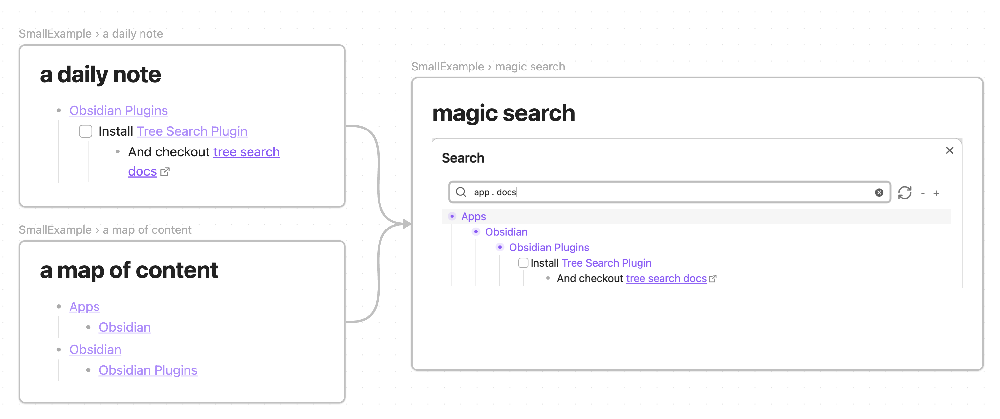

# Obsidian TreeSearch Plugin

This is a plugin for Obsidian to help navigate a hierarchy of notes and connections that are built as you type.
No special annotation, just record relations whenever you want them.

**Documentation:** https://catacgc.github.io/obsidian-tree-search/ (sources in [docs/](docs/index.md)).
