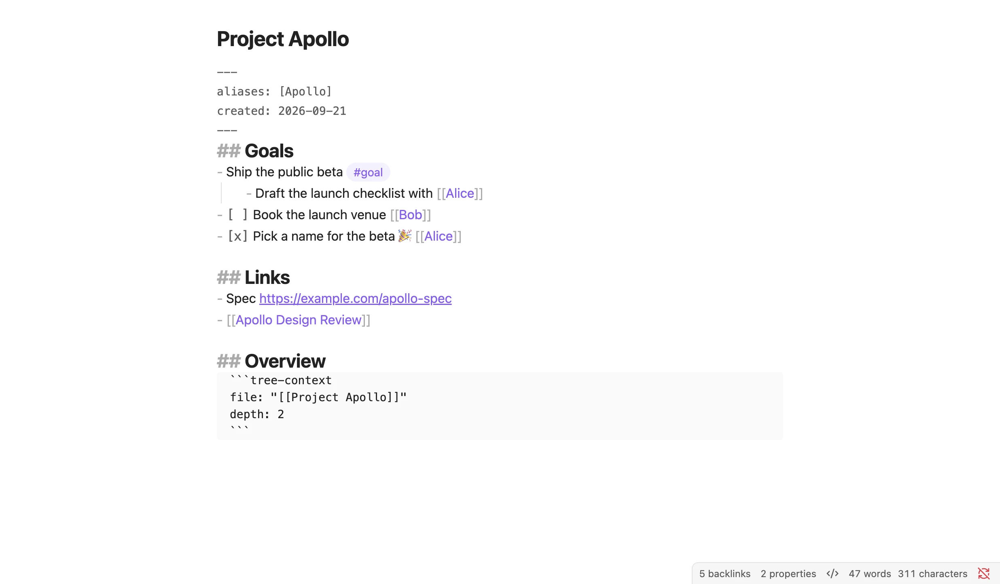
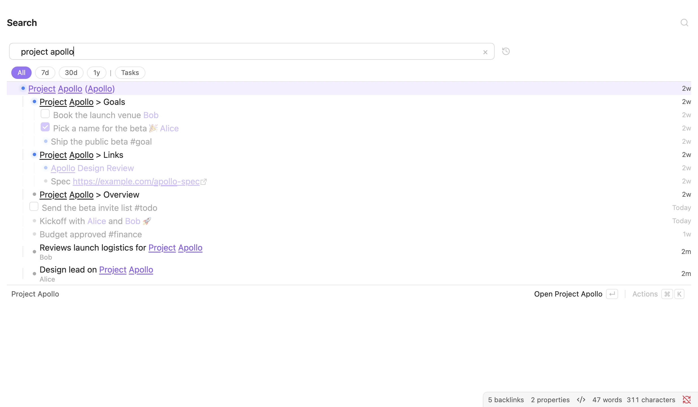
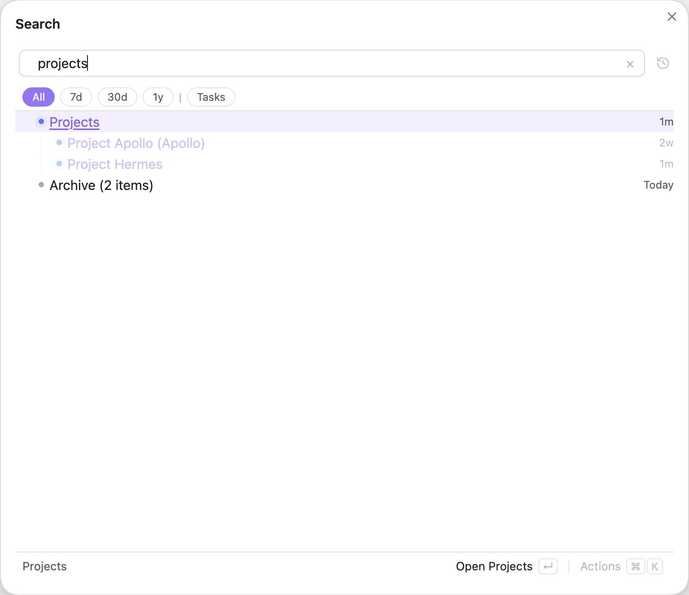
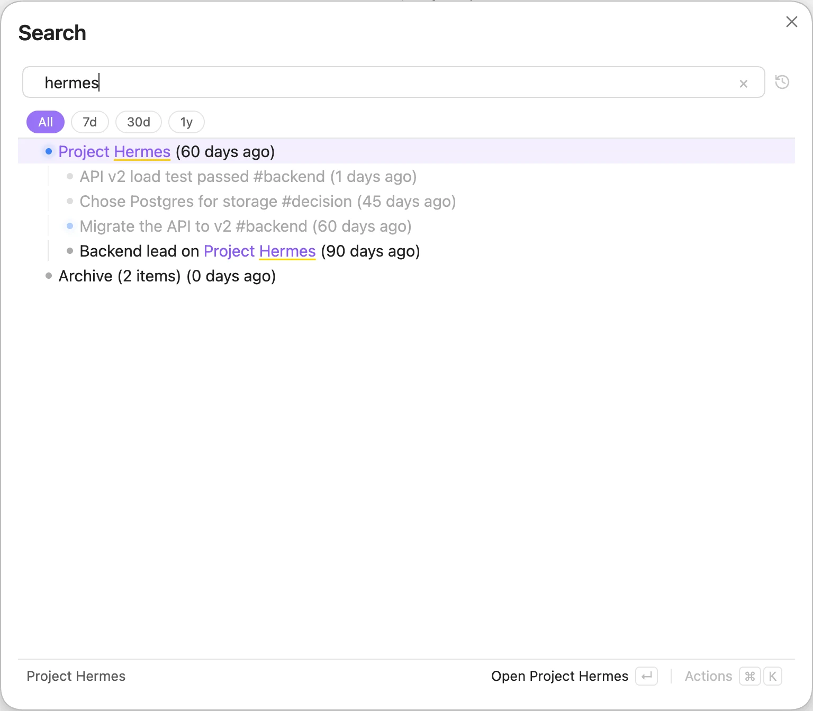
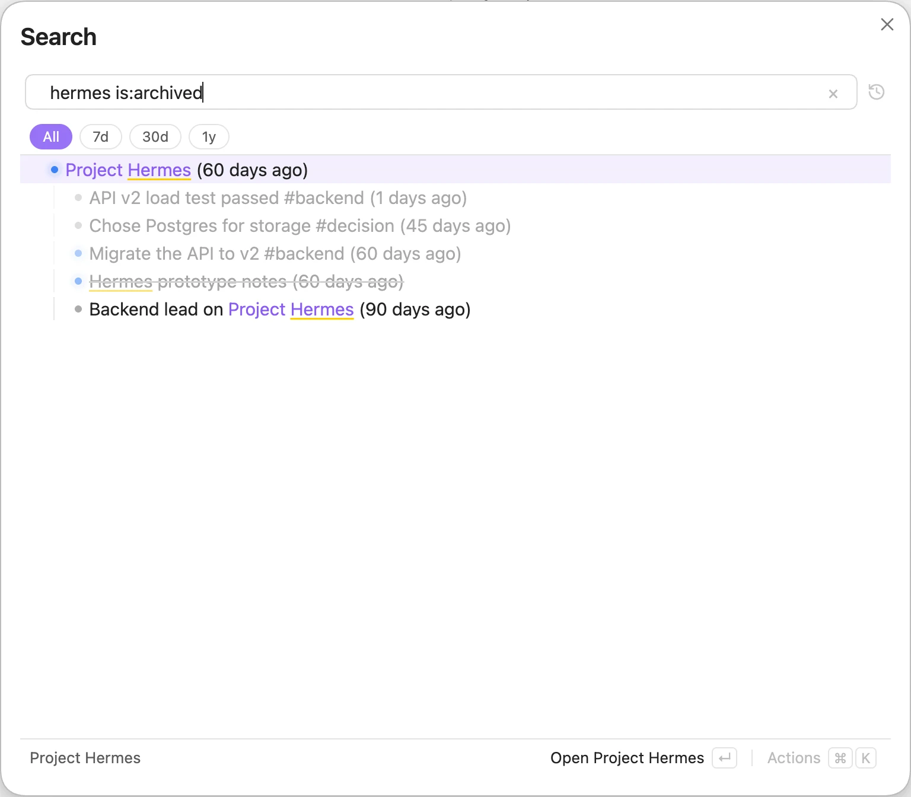

# Building the tree

Tree Search builds its tree from the structure you already write. There is nothing to configure first: open a vault and the tree is there.

## Headings, bullets and links

Inside a note, three things create parent/child relationships:

- **Headings.** Lines under a heading become its children.
- **Nested bullets.** An indented bullet is a child of the bullet above it.
- **Links in bullets.** A bullet that contains a `[[link]]` is also a child of the linked note.

Here is the `Project Apollo` note from the example vault:


*`Work/Project Apollo.md`: headings, nested bullets, tasks and links.*

And here is the tree Tree Search builds for it:


*Searching for `project apollo`: the note's own outline, plus lines from other notes that link to it.*

The last point matters most. When you write a line in a daily note that links to `[[Project Apollo]]`, that line shows up under Project Apollo. You can keep writing in your daily notes and still find everything by topic later.

## Parents in frontmatter

You can also give a note a parent in its frontmatter:

```yaml
---
parent: "[[Projects]]"
---
```

The key is `parent` by default. You can change it in [Settings](panes-and-integrations.md#settings).


*Searching for `projects`. Project Apollo comes in through a bullet in Tree Search Examples; Project Hermes through its frontmatter.*

## What gets indexed

A few rules decide what ends up in the tree:

- **Only the leading outline is indexed.** Tree Search reads the bullets at the start of a note. The first line that is neither a bullet nor a heading ends the outline; blank lines don't. Put your bullets first and any prose after them.
- **A bullet needs a link, a tag or a URL.** Plain bullets without `[[`, `#tag` or `http` are not indexed on their own.
- **Aliases are searchable.** A note with `aliases: [Apollo]` is found when you search for `apollo`.
- **Folders, canvases and attachments are indexed too.** Search for `is:folder` to see folders.
- **Dates.** A line or note gets its date from a `YYYY-MM-DD` in the file name or the line itself. If there is none, Tree Search uses the frontmatter `updated` or `created` field, then your Daily Notes format.

## Archiving

Archive things you no longer need without deleting them. You can archive:

- a line, with the **Archive** action, which adds `(meta-mdtree:: archive)` to the end of the line. Everything nested under it is archived with it;
- a whole note, by adding `archive` to its frontmatter `tags`.

The tag is `archive` by default and can be changed in [Settings](panes-and-integrations.md#settings). A bullet tagged `#archive` is left out of the index entirely, so it won't show up even with `is:archived`.

Archived items are hidden from results. Tree Search collapses them into a single row so you know they are there.


*Searching for `hermes`: the archived prototype notes are folded into an "Archive (N items)" row.*

Add `is:archived` to your query to bring them back.


*`hermes is:archived` shows the archived items, greyed out.*
