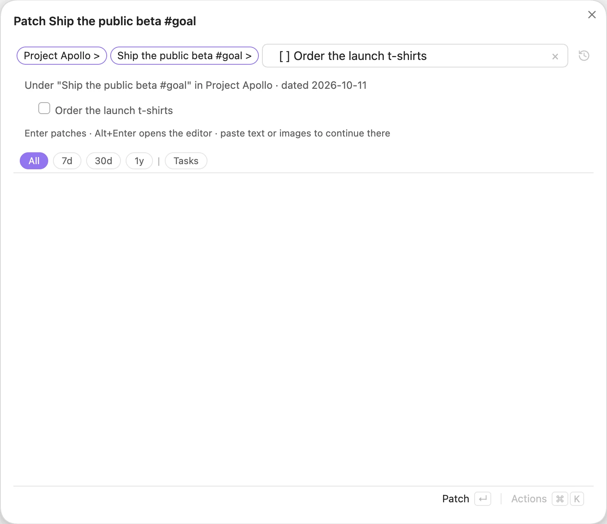

# Editor

Tree Search is not only for finding things. You can write into your vault straight from the search results.

## Quick Add

Select a note row and press <kbd>Alt</kbd>+<kbd>A</kbd>, or click the ⊕ on the row. The Search modal or pane switches to the editor, with a `- [[Note]]` bullet ready for you. When you save, the bullets are written into today's daily note, so the new lines show up under that note in the tree, and you are back at your search with the new line selected. <kbd>Esc</kbd> also takes you back to the search.

The **Tree Search: Quick Add** command (also **Open editor**, or <kbd>Alt</kbd>+<kbd>N</kbd> in a search) opens Search in Quick Add mode, titled **Quick Add**. Type to search: <kbd>Enter</kbd> on a note, heading or line (**Patch** and its name in the footer) picks it to add under, as <kbd>&gt;</kbd> does (see [Patch mode](#patch-mode)). When what you type matches nothing, <kbd>Enter</kbd> (**Add**) writes it into today's daily note, and the box clears for the next one. <kbd>Alt</kbd>+<kbd>Enter</kbd> with nothing typed opens your draft in the editor; <kbd>Esc</kbd> goes back to a normal search.

*Appending "Confirmed the launch date" under `[[Project Apollo]]`.*

Your draft is kept when you close the editor, and even when you restart Obsidian. It stays until you **Save** (<kbd>Shift</kbd>+<kbd>Enter</kbd> or <kbd>Cmd/Ctrl</kbd>+<kbd>Enter</kbd>) or **Discard** it.

## Linking while you type

Type `[[` in the editor and Tree Search suggests notes from the tree. To link a heading, type part of the note name, `#`, then part of the heading: `[[not#hea` finds `Note#Header1` and `Noting#Heading`. Press <kbd>Enter</kbd> or <kbd>Tab</kbd> to accept a suggestion. When no note has the exact name you typed, a **New note `[[name]]`** row sits above the suggestions: press <kbd>↑</kbd> from the first suggestion to select it (it is selected already when nothing matches). It inserts the link; the note is created only if you add content to it.

*Typing `[[bob` suggests notes from the tree; suggestions start after three characters.*

## Editing a line in place

Select a row and press <kbd>Alt</kbd>+<kbd>Enter</kbd>, or <kbd>Alt</kbd>-click it, to edit that line where it was written. On a heading this renames the heading; on an attachment (an image, a PDF) it renames the file, and Obsidian updates the links to it. The Search modal's title says what you are doing: **Edit**, **Rename**, or **Patch** while you build a `>` chain.

*Editing "Budget approved" without leaving the search.*

## Quick Link

Run the **Tree Search: Quick Link** command while you are writing a note. Search for a note or heading and pick it to insert `[[Note]]` or `[[Note#Heading]]` at your cursor.

*Quick Link for `apollo`.*

## Patch mode

Patch mode adds to your vault from the search box. In the Search modal or pane, select a row and type <kbd>&gt;</kbd>, or choose **Patch** in the action panel. The row becomes a chip in the search box, the Search modal's title becomes **Patch** and the row's name, and the search now looks under it. To go one level deeper, press <kbd>Enter</kbd> on a result (the footer shows **Patch** and the result's name) or type <kbd>&gt;</kbd> on it. Then type what to add, and press <kbd>&gt;</kbd> to make it a chip too:

| Type | Adds |
| --- | --- |
| `- text`, `[ ] task` | a bullet or a task |
| `[[Note]]` | a link to the note; the note is created if it doesn't exist |
| `\|alias` | an alias on the current note |
| `#heading` | a heading in the current note (`## heading` at its end) |
| `(key:: value)` | a property on the current note, e.g. `(is:: project)` or `(parent:: [[Area]])` |

*`Project Apollo > Ship the public beta` with a task typed: the preview shows where <kbd>Enter</kbd> writes it.*

The preview under the search box shows what will be written. <kbd>Enter</kbd> (**Patch**) writes the whole chain, then clears the box and selects the new line, so you can add the next one under the same chips. Text that matches rows under the chips stays a search; start it with `- ` to add it instead.

Where it goes:

- **Under a note or heading:** into today's daily note, under a link to it.
- **Under a line:** as that line's last children, in its own note.
- **With nothing selected:** into today's daily note. The search box is pre-filled with an item that matches the search, so `is:task #home` gives `- [ ] #home ` (words, tags and `[[links]]` as typed; `is:completed` gives `- [x] `, `has:link` a trailing `[[`). A search that is just a closed link such as `[[New idea]]` adds under that note, even when it doesn't exist yet.

Each new line gets a `[created:: date]` (or `[scheduled:: date]` for a task) so it is indexed; a bullet that is only a link stays as it is. For example, `Note > [[New Node]] > |new-alias > #header > [ ] task` creates *New Node* with that alias and heading, and adds the task under `[[New Node#header]]`. An alias, heading or property alone (`Note > (is:: project)`) only changes the note.

<kbd>Alt</kbd>+<kbd>Enter</kbd>, or pasting a list or an image, continues in the editor. Pasting other text opens the whole note to write in. <kbd>Backspace</kbd> in an empty search box drops the last chip; <kbd>Esc</kbd> drops them all. Nothing is written before <kbd>Enter</kbd>.

The editor understands the same patches on a bullet that is only a link: `- [[Note|alias]]`, `- [[Note#heading]]` and `- [[Note]] (key:: value)`.

In the editor, <kbd>Alt</kbd>+<kbd>Enter</kbd> on a line without a link opens the whole note: the note you are adding to, today's daily note, or, under a line, a new note that Save links from that line.

## Move under

To move a note or line, select it and type <kbd>&lt;</kbd>, press <kbd>Alt</kbd>+<kbd>M</kbd>, or choose **Move under…** in the action panel. The row becomes a chip, and the search now looks for its new parent: any note in the vault, not only the ones in the results. Select one and press <kbd>Enter</kbd> (the footer shows **Move under**). <kbd>Alt</kbd>+<kbd>M</kbd> and **Move under…** work in every search view, including on mobile; <kbd>&lt;</kbd> works where you can edit (the Search modal and pane).

*Moving "Budget approved": searching `hermes` for its new parent.*

| You move | It can go under | What changes |
| --- | --- | --- |
| a line | a note or heading | the line, with everything nested under it, moves to today's daily note, under a link to the note or heading |
| a line | another line | it becomes that line's last child, in that line's note |
| a note | another note | its `parent` property (the parent relation in settings) becomes the new note |
| a note, folder or attachment | a folder | the file or folder moves there |

Headings can't be moved; move their note or their lines. If nothing matches what you typed, press <kbd>Enter</kbd> twice to move a note or line under a new note with that name. <kbd>Esc</kbd>, or <kbd>Backspace</kbd> in an empty search box, cancels the move.

A line moved to another note keeps its date: each undated line in it gets `[created:: date]` with the date of the note it came from (the date in its name, its `updated`/`created` property, or its daily note's day).

In Tree mode on desktop you can also drag a row onto a note row in the results to move it under that note. A line dragged to another note keeps its date the same way.

### Moving many rows: the cut drawer

In the Search modal and pane, <kbd>⌘</kbd>+<kbd>X</kbd> (<kbd>Ctrl</kbd>+<kbd>X</kbd> on Windows and Linux) cuts the selected row into a drawer above the footer, and marks it with a dashed outline. Press it again on a cut row to take it out. Collect rows from as many searches as you need: the drawer is shared by the modal and the pane and stays until Obsidian reloads the plugin. The action panel offers the same as **Cut to drawer** / **Take out of drawer**.

The drawer's actions (also in the action panel's **Drawer** section):

- **Move under…** starts a move of every cut row (the chip reads **3 items <**). Pick the new parent and press <kbd>Enter</kbd>: the rows move in the order you cut them, following the table above. A cut line inside another cut line moves with its parent.
- **Archive** archives every cut line and note. Folders and attachments can't be archived.
- **Clear** empties the drawer; **×** takes one row out.

Rows that moved or were archived leave the drawer. The rest stay, and a notice lists why each one failed (for example, a folder can only go under a folder).

## More editing

- **Patch, Rename, Delete.** The action panel's Edit section also has **Patch** (the same as typing <kbd>&gt;</kbd> on the row), **Rename [[Note]]** for each note or embedded file on the row (Obsidian updates the links to it), and **Delete**, which asks first. Delete removes a line with everything nested under it, a heading with its section, or moves a note's own row or an attachment to the trash.
- **Note content.** Clicking a link in the editor (or pressing <kbd>Alt</kbd>+<kbd>Enter</kbd> on it) opens a content section that is appended to that note. The note is created if it doesn't exist yet.
- **Pasting.** Pasted files are saved into your vault and named after the note. Pasted URLs become markdown links.
- **Indenting.** Press <kbd>Tab</kbd> and <kbd>Shift</kbd>+<kbd>Tab</kbd> to indent and outdent.
- **Scheduling.** On a task line, type `@` and pick **Today**, **Tomorrow**, **Weekend** (next Saturday) or **Later** (Tuesday next week); keep typing to filter (`@tom`). <kbd>Enter</kbd> or <kbd>Tab</kbd> replaces it with the task's `[scheduled:: date]`, <kbd>Esc</kbd> closes the list. It works in a `>` chain's task entry (`[ ] call Bob @tom`) too.

See [Shortcuts](shortcuts.md) for every key inside the editor.
