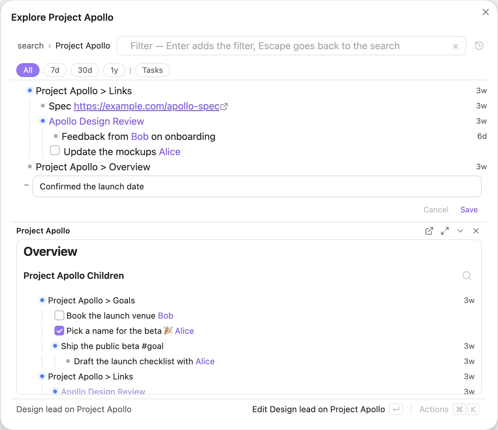
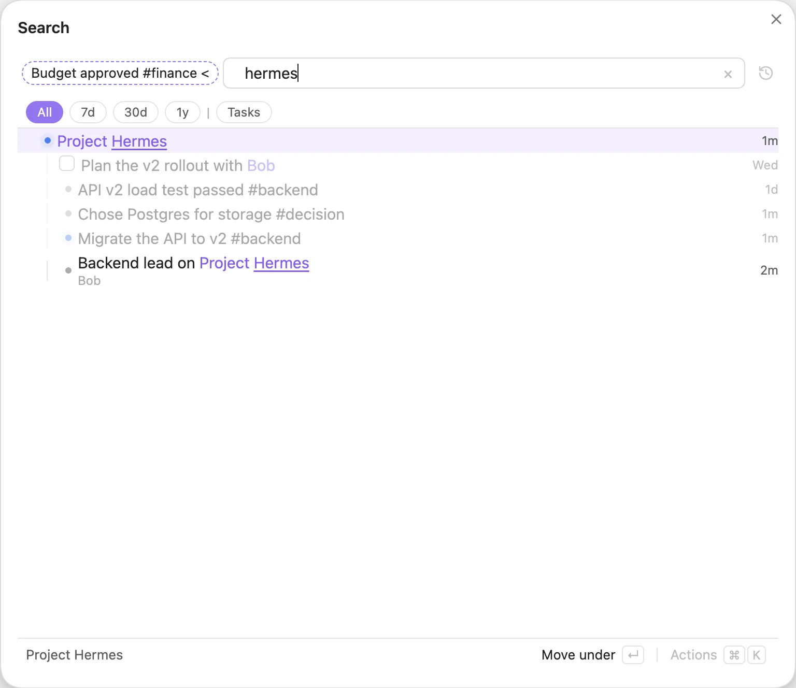

# Editor

Tree Search is not only for finding things. You can write into your vault straight from the search results.

## Quick Add

The **Tree Search: Quick Add** command (also **Open editor**) opens a Search modal and, from there, <kbd>Alt</kbd>+<kbd>A</kbd> with no search and no row selected does the same (see [Add to](#add-to)): it opens the [outline editor](#the-outline-editor) on today's daily note, titled **Quick Add**, with a new line open: type it and press <kbd>Enter</kbd> to save.

## Add to

Press <kbd>Alt</kbd>+<kbd>A</kbd> (or pick **Add to …** in the action panel, or the last row of the results) to add a line. With a row selected, the Search modal or pane opens that row as an [outline](#the-outline-editor) and puts a new line at its end; with nothing selected and a search typed, the line goes to the end of the results, written to today's daily note; with nothing selected and no search, today's daily note is opened as the outline (titled **Quick Add**) with the new line open. Type the line and press <kbd>Enter</kbd> to save.

*Adding "Confirmed the launch date" under Project Apollo.*

## Linking while you type

Type `[[` in the editor and Tree Search suggests notes from the tree. To link a heading, type part of the note name, `#`, then part of the heading: `[[not#hea` finds `Note#Header1` and `Noting#Heading`. Press <kbd>Enter</kbd> or <kbd>Tab</kbd> to accept a suggestion. When no note has the exact name you typed, a **New note `[[name]]`** row sits above the suggestions: press <kbd>↑</kbd> from the first suggestion to select it (it is selected already when nothing matches). It inserts the link; the note is created only if you add content to it.

*Typing `[[bob` suggests notes from the tree; suggestions start after three characters.*

## The outline editor

The outline editor turns the results in the Search modal or pane into a browsable outline. It has one navigation behavior: **Explore**. The modal title is **Explore** plus the root or query; Quick Add stays titled **Quick Add** at Today.

**Opening and exploring.** Enter on a note, heading or line with children, clicking a selected row again, clicking a note link in a row, or **Open** in the action panel opens that row's whole tree. The ⊕ under a hovered row, `>` on a selected row, and **Add to …** with a selected row also open the tree. Inside the outline, these actions descend another level. The outline keeps every row expanded and lists siblings in file order.

**Ordinary Enter** does what fits the selected row (the footer names it):

| Row | <kbd>Enter</kbd> |
|---|---|
| A note or heading | Explore it: open its tree, or inside the outline add it to the breadcrumb |
| A line with a web link | Open the link (e.g. **Browse 🔗 https://…**); the Search modal closes unless you have unsaved edits |
| A line with lines under it | Explore it |
| A task with nothing under it | **Complete task** (on a done task: **Reopen task**) |
| A line with a `` `snippet` `` and nothing under it | **Copy** the snippet; the Search modal closes unless you have unsaved edits |
| Any other line with nothing under it | **Edit** its source line in place |

A second click explores a selected page, heading or line. A task is completed only by clicking its checkbox, and a snippet is copied only by clicking the snippet itself.

**Editing the selected row directly.** <kbd>Alt</kbd>+<kbd>Enter</kbd>, <kbd>Alt</kbd>-click, or the row-specific **Edit**/**Rename** action in the panel acts on the selected row without opening or changing the outline. A page's own row opens its note's **Rename** editor; a page-link row edits the source link line; a heading or text row opens its source line editor; an attachment opens **Rename**. With no selected row in plain search, Alt+Enter does nothing; inside the outline it uses Enter's row target (the first non-archive row if none is selected). The action panel has no row action without a selection.

Typing in the outline's search box filters its rows: a matching line stays with its parents and everything under it. With a selected row, Enter runs that row's ordinary behavior and keeps the typed text as a filter. With text but no row selected, Enter makes a filter crumb (`search › Project Apollo › is:task`); crumbs add up. Backspace in an empty search box drops the last crumb. Lines edited or added inside the outline stay listed even when they no longer match the filter, with a red outline.

**Editing a line.** The line editor keeps the bullet, checkbox or `#` prefix outside the field. In the Search modal or pane, Alt+Enter on a heading, text row or page-link row opens the editor at that source line; Alt-click does the same. Ordinary Enter on a plain leaf line also edits it after the web-link, children, task and snippet actions above. Inside the line editor, Alt+Enter adds a line under it, Tab and Shift+Tab indent and outdent, and `[[`, `@`, pasting and formatting keys work as described below. A line the filter would hide gets a red outline; you can still save it. Enter, Ctrl+Enter or Shift+Enter saves; new lines go where typed, each with a `[created:: date]` (or `[scheduled:: date]` for a task). If the line changed in its note in the meantime, nothing is written. Esc cancels; with changes, press it twice to discard them.

**Adding a line.** The **Add to …** row at the end of the results (for example **Add to Project Apollo…**), or **Add to …** in the action panel, adds a line without touching an existing one. Click it, or press <kbd>↓</kbd> past the last row to select it and then <kbd>Enter</kbd>. In the search it is there too: with a row selected (for example **Add to Ship the public beta…**) it explores that row and opens a new line at its end; with nothing selected (**Add to Today…**) it opens a new line at the end of the results. The line goes:

- **Under a note or heading:** into today's daily note, under a link to it.
- **Under a line:** as that line's last child, in its own note.
- **Under the search or today:** into today's daily note.

**Leaving.** Click the `search` crumb, press <kbd>Esc</kbd> in the search box, or <kbd>Backspace</kbd> in an empty search box with no crumb left. You are back at the search you came from, with the same row selected. With unsaved changes, a notice warns you once; leaving again discards them.

### The note's content

A pane above the footer shows the text of the outline root's note (for a heading, only the text under it, titled **Note › Heading**) or the page/header associated with a line being edited. Enter on a page or heading explores its tree; the root's text appears in this pane. Alt+Enter on a page's own row opens its **Rename** editor instead. The pane starts collapsed to its title when the note has no text besides its outline. **Save** and **Discard** (back to the text on disk) show only while the pane is focused. Files you paste or drop into it are saved into your vault and named after the note. A dot by the title marks unsaved changes. **Save**, or <kbd>Ctrl</kbd>+<kbd>Enter</kbd> (<kbd>⌘</kbd>+<kbd>Enter</kbd> on macOS) in the pane, the line editor or the search box, saves the line and the content together. If the note changed in the meantime, nothing is written. The pane's buttons open the note in Obsidian, expand the pane to fill the view, collapse it to its title, or close it. <kbd>Esc</kbd> in the pane goes back to the search box.

To open in Obsidian instead, press <kbd>Shift</kbd>+<kbd>Enter</kbd> (See in Obsidian), choose **Open … in Obsidian** in the action panel, <kbd>Ctrl</kbd>/<kbd>⌘</kbd>-click a link in a row, or click the pane's open button. Folders and attachments still open in Obsidian.

## Quick Link

Run the **Tree Search: Quick Link** command while you are writing a note. Search for a note or heading and pick it to insert `[[Note]]` or `[[Note#Heading]]` at your cursor.

*Quick Link for `apollo`.*

## Move under

To move a note or line, select it and type <kbd>&lt;</kbd>, press <kbd>Alt</kbd>+<kbd>M</kbd>, or choose **Move under…** in the action panel. The row becomes a chip, and the search now looks for its new parent: any note in the vault, not only the ones in the results. Select one and press <kbd>Enter</kbd> (the footer shows **Move under**). <kbd>Alt</kbd>+<kbd>M</kbd> and **Move under…** work in every search view, including on mobile; <kbd>&lt;</kbd> works where you can edit (the Search modal and pane).

*Moving "Budget approved": searching `hermes` for its new parent.*

| You move | It can go under | What changes |
| --- | --- | --- |
| a line | a note or heading | the line, with everything nested under it, moves to today's daily note, under a link to the note or heading |
| a line | another line | it becomes that line's last child, in that line's note |
| a note | another note | its `parent` property (the parent relation in settings) becomes the new note |
| a note, folder or attachment | a folder | the file or folder moves there |

Headings can't be moved; move their note or their lines. If nothing matches what you typed, press <kbd>Enter</kbd> twice to move a note or line under a new note with that name. <kbd>Esc</kbd>, or <kbd>Backspace</kbd> in an empty search box, cancels the move.

A line moved to another note keeps its date: each undated line in it gets `[created:: date]` with the date of the note it came from (the date in its name, its `updated`/`created` property, or its daily note's day).

In Tree mode on desktop you can also drag a row onto a note row in the results to move it under that note. A line dragged to another note keeps its date the same way.

### Moving many rows: the cut drawer

In the Search modal and pane, <kbd>⌘</kbd>+<kbd>X</kbd> (<kbd>Ctrl</kbd>+<kbd>X</kbd> on Windows and Linux) cuts the selected row into a drawer above the footer, and marks it with a dashed outline. Press it again on a cut row to take it out. Collect rows from as many searches as you need: the drawer is shared by the modal and the pane and stays until Obsidian reloads the plugin. The action panel offers the same as **Cut to drawer** / **Take out of drawer**.

The drawer's actions (also in the action panel's **Drawer** section):

- **Move under…** starts a move of every cut row (the chip reads **3 items <**). Pick the new parent and press <kbd>Enter</kbd>: the rows move in the order you cut them, following the table above. A cut line inside another cut line moves with its parent.
- **Archive** archives every cut line and note. Folders and attachments can't be archived.
- **Clear** empties the drawer; **×** takes one row out.

Rows that moved or were archived leave the drawer. The rest stay, and a notice lists why each one failed (for example, a folder can only go under a folder).

## More editing

- **Edit, Rename, Delete.** Alt+Enter's action-panel item is **Rename** for a page's own row or an attachment, and **Edit** for a heading, text row or page-link line. The panel also keeps explicit **Rename [[Note]]** targets for linked notes and embedded files, plus **Delete**, which asks first. Delete removes a line with everything nested under it, a heading with its section, or moves a note's own row or an attachment to the trash.
- **Note content.** Clicking a link in the editor (or pressing <kbd>Alt</kbd>+<kbd>Enter</kbd> on it) opens a content section that is appended to that note. The note is created if it doesn't exist yet.
- **Pasting.** Pasted files are saved into your vault and named after the note. Pasted URLs become markdown links.
- **Indenting.** Press <kbd>Tab</kbd> and <kbd>Shift</kbd>+<kbd>Tab</kbd> to indent and outdent.
- **Scheduling.** On a task line, type `@` and pick **Today**, **Tomorrow**, **Weekend** (next Saturday) or **Later** (Tuesday next week); keep typing to filter (`@tom`). <kbd>Enter</kbd> or <kbd>Tab</kbd> replaces it with the task's `[scheduled:: date]`, <kbd>Esc</kbd> closes the list. It works in the outline editor's line editor too.

See [Shortcuts](shortcuts.md) for every key inside the editor.
