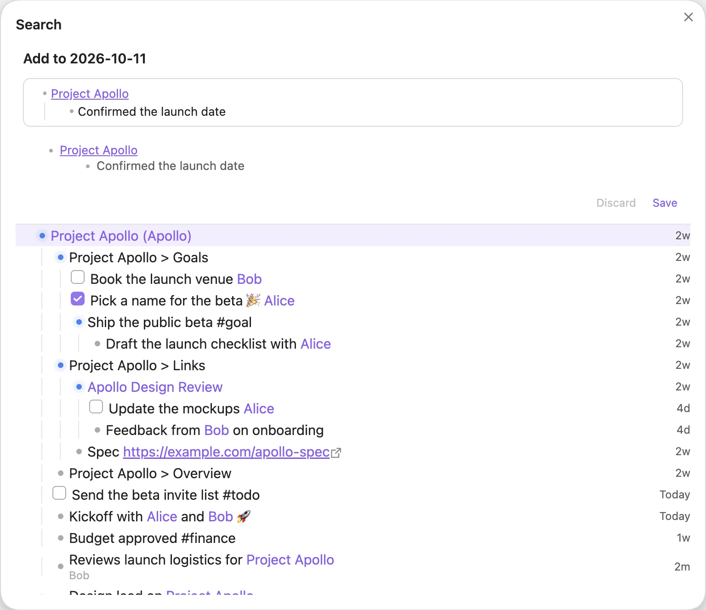
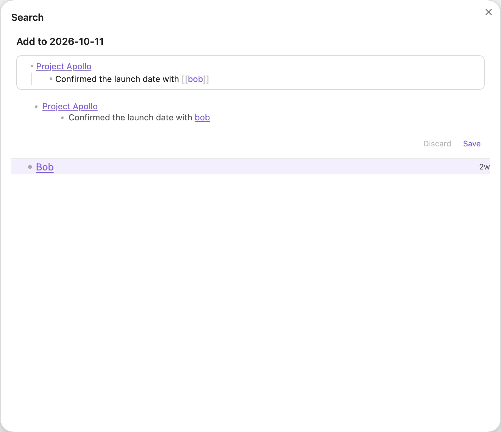
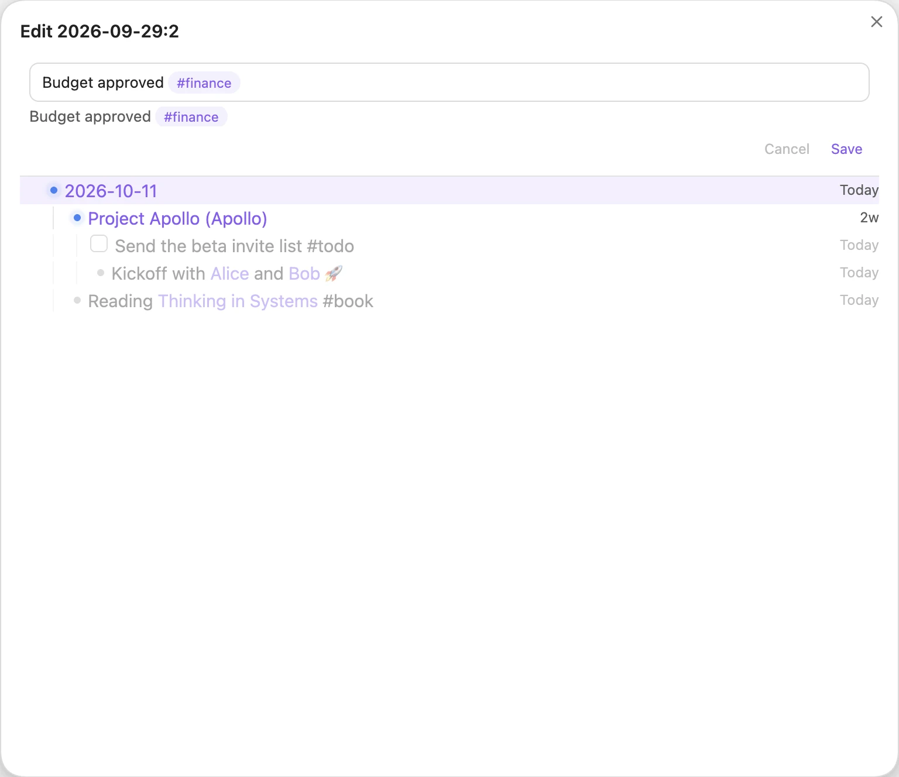
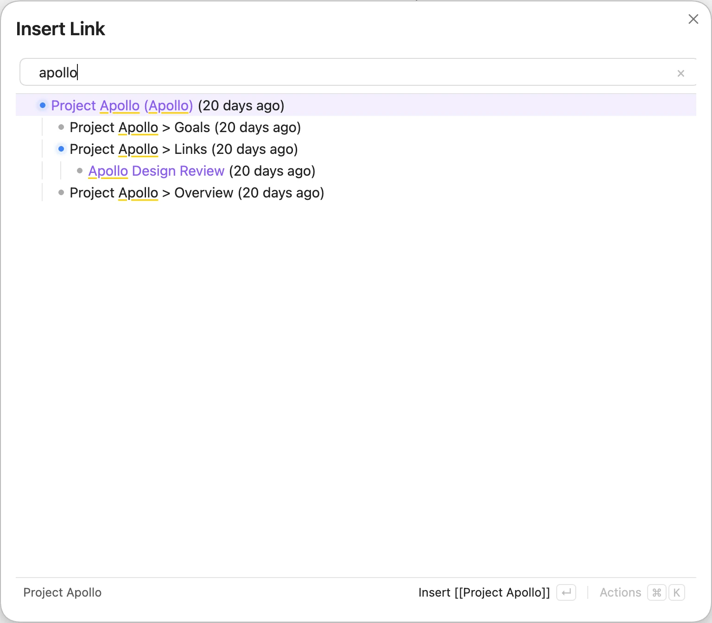

# Editor

Tree Search is not only for finding things. You can write into your vault straight from the search results.

## Quick Add

Select a note row and press <kbd>Alt</kbd>+<kbd>A</kbd>, or click the ⊕ on the row. The Search modal or pane switches to the editor, with a `- [[Note]]` bullet ready for you. When you save, the bullets are written into today's daily note, so the new lines show up under that note in the tree, and you are back at your search with the new line selected. <kbd>Esc</kbd> also takes you back to the search.

You can also open the editor in its own window with the **Tree Search: Quick Add** command.

*Appending "Confirmed the launch date" under `[[Project Apollo]]`.*

Your draft is kept when you close the editor, and even when you restart Obsidian. It stays until you **Save** (<kbd>Shift</kbd>+<kbd>Enter</kbd> or <kbd>Cmd/Ctrl</kbd>+<kbd>Enter</kbd>) or **Discard** it.

## Linking while you type

Type `[[` in the editor and Tree Search suggests notes from the tree. Press <kbd>Enter</kbd> or <kbd>Tab</kbd> to accept a suggestion. When no note has the exact name you typed, a **New note `[[name]]`** row sits above the suggestions: press <kbd>↑</kbd> from the first suggestion to select it (it is selected already when nothing matches). It inserts the link; the note is created only if you add content to it.

*Typing `[[bob` suggests notes from the tree; suggestions start after three characters.*

## Editing a line in place

Select a row and press <kbd>Alt</kbd>+<kbd>Enter</kbd>, or <kbd>Alt</kbd>-click it, to edit that line where it was written. On a heading this renames the heading; on an attachment (an image, a PDF) it renames the file, and Obsidian updates the links to it. The Search modal's title says what you are doing: **Edit**, **Rename**, or **Patch** while you build a `>` chain.

*Editing "Budget approved" without leaving the search.*

## Quick Link

Run the **Tree Search: Quick Link** command while you are writing a note. Search for a note or heading and pick it to insert `[[Note]]` or `[[Note#Heading]]` at your cursor.

*Quick Link for `apollo`.*

## Adding from Search

In the Search modal or pane, select a row and type <kbd>&gt;</kbd>. It becomes a chip in the search box, and the search now looks under it. Type <kbd>&gt;</kbd> on a result to go deeper, or type what to add and press <kbd>&gt;</kbd> again to make it a chip:

| Type | Adds |
| --- | --- |
| `- text`, `[ ] task` | a bullet or a task |
| `[[Note]]` | a link to the note; the note is created if it doesn't exist |
| `\|alias` | an alias on the current note |
| `#heading` | a heading in the current note (`## heading` at its end) |
| `(key:: value)` | a property on the current note, e.g. `(is:: project)` or `(parent:: [[Area]])` |

The preview under the search box shows what will be written. <kbd>Enter</kbd> writes the whole chain: under a note or heading, into today's daily note; under a line, as that line's last children in its own note, each with a `[created:: date]` (or `[scheduled:: date]` for a task) so it is indexed. With nothing selected, it goes to today's daily note; a search that is just a closed link such as `[[New idea]]` adds under that note, even when it doesn't exist yet. For example, `Note > [[New Node]] > |new-alias > #header > [ ] task` creates *New Node* with that alias and heading, and adds the task under `[[New Node#header]]`. An alias, heading or property alone (`Note > (is:: project)`) only changes the note.

<kbd>Alt</kbd>+<kbd>Enter</kbd>, or pasting a list or an image, continues in the editor. Pasting other text opens the whole note to write in. <kbd>Backspace</kbd> in an empty search box drops the last chip; <kbd>Esc</kbd> drops them all. Nothing is written before <kbd>Enter</kbd>.

The editor understands the same patches on a bullet that is only a link: `- [[Note|alias]]`, `- [[Note#heading]]` and `- [[Note]] (key:: value)`.

In the editor, <kbd>Alt</kbd>+<kbd>Enter</kbd> on a line without a link opens the whole note: the note you are adding to, today's daily note, or, under a line, a new note that Save links from that line.

Type <kbd>&lt;</kbd> instead to move the selected note or line. Search for its new parent (a note, a heading, a line or, for notes, a folder) and press <kbd>Enter</kbd>. If nothing matches, pressing <kbd>Enter</kbd> twice moves it under a new note with the typed name. <kbd>Esc</kbd>, or <kbd>Backspace</kbd> in an empty search box, cancels the move.

The same move is **Move to…** (<kbd>Alt</kbd>+<kbd>M</kbd>, or the action panel) in every search view. It also moves folders and attachments into another folder.

## More editing

- **Reparent by dragging.** In Tree mode on desktop, drag a row onto a note row to move it under that note. You can also use **Move under…**.
- **Patch, Rename, Delete.** The action panel's Edit section also has **Patch** (the same as typing <kbd>&gt;</kbd> on the row), **Rename [[Note]]** for each note or embedded file on the row (Obsidian updates the links to it), and **Delete**, which asks first. Delete removes a line with everything nested under it, a heading with its section, or moves a note's own row or an attachment to the trash.
- **Note content.** Clicking a link in the editor (or pressing <kbd>Alt</kbd>+<kbd>Enter</kbd> on it) opens a content section that is appended to that note. The note is created if it doesn't exist yet.
- **Pasting.** Pasted files are saved into your vault and named after the note. Pasted URLs become markdown links.
- **Indenting.** Press <kbd>Tab</kbd> and <kbd>Shift</kbd>+<kbd>Tab</kbd> to indent and outdent.

See [Shortcuts](shortcuts.md) for every key inside the editor.
