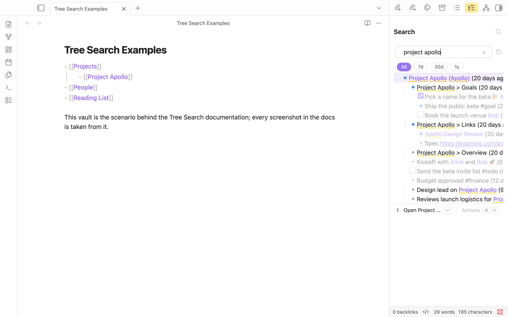
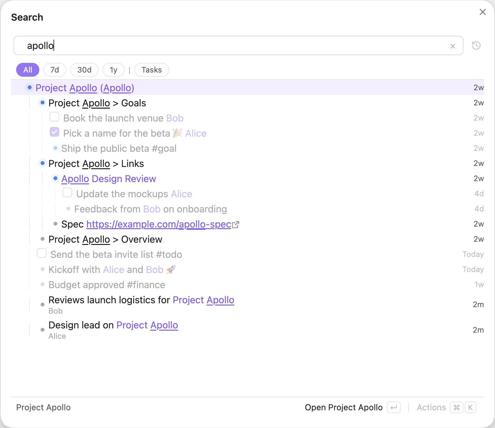

# Tree Search

Tree Search turns the links and bullets you already write into a searchable tree.

You don't need any special syntax, and Dataview is not required. Keep writing notes the way you do today: headings, nested bullets, `[[links]]` and `#tags`. Tree Search reads them and shows you how everything fits together.


*The Tree Search Examples vault, with the Search pane showing everything about Project Apollo.*

Search from anywhere with the Search modal. Results come back as a tree, so you see each match together with the notes and lines it lives under.


*The Search modal for `apollo`: the project note, the lines inside it, and every line that links to it.*

## Install

Open **Settings → Community plugins → Browse**, search for **Tree Search**, then install and enable it.

To try beta versions, install it through [BRAT](https://github.com/TfTHacker/obsidian42-brat) with this repository:

```
https://github.com/catacgc/obsidian-tree-search
```

## Try it

Every screenshot in these docs comes from a small example vault. Its entry note is `Tree Search Examples`, and it links to a few projects, people and a reading list.

You can browse the [example vault sources on GitHub](https://github.com/catacgc/obsidian-tree-search/tree/main/docs/example-vault) and copy them into a vault of your own to follow along.

## Where next

- [Building the tree](building-the-tree.md): how your notes become a tree, what gets indexed, and archiving.
- [Searching](searching.md): the Search modal and pane, hierarchical search, recency, the timeline and actions.
- [Query language](query-language.md): every operator, filter and shortcut.
- [Editor](editor.md): Quick Add, adding from Search, inline editing and Quick Link.
- [Panes & integrations](panes-and-integrations.md): File context, Consolidate notes, the `tree-context` code block, settings, Raycast and the CLI.
- [Shortcuts](shortcuts.md): every keyboard shortcut.
