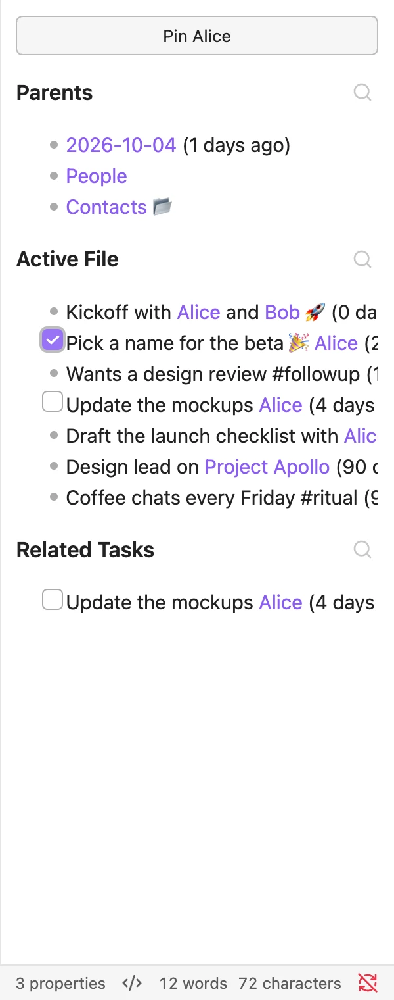
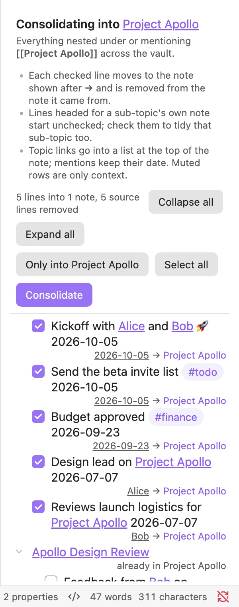
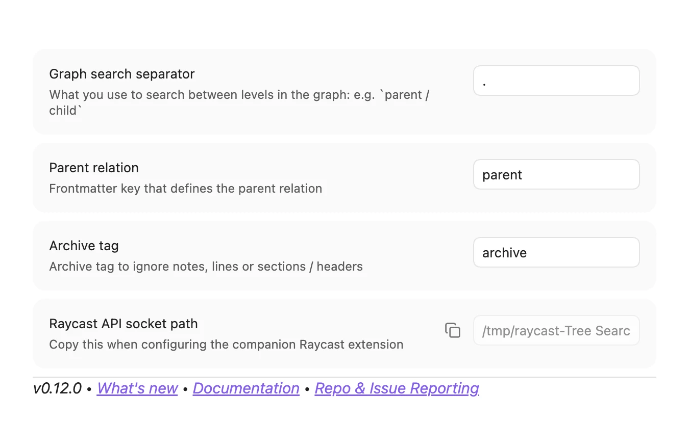

# Panes & integrations

## File context

Run **Tree Search: File context** to open a pane that follows the note you are working in. It shows the active note's parents, its children and related tasks.

Use **Pin** to keep the pane on one note while you move around the vault.


*File context for `Alice`.*

## Consolidate notes

Over time, lines about a topic end up scattered across daily notes and other pages. Run **Tree Search: Consolidate notes** on a note to collect them. Pick the lines written elsewhere and Tree Search moves them into the note.


*Consolidating lines about Project Apollo into its note.*

## The tree-context code block

Embed a live tree inside any note with a `tree-context` code block. This is the one at the end of `Work/Project Apollo.md`:

````markdown
```tree-context
file: "[[Project Apollo]]"
depth: 2
```
````


*The code block rendered in reading view.*

The block accepts these keys:

| Key | Meaning |
| --- | --- |
| `file` | Target file, as `"[[file]]"` or `"[[file#header]]"`. Defaults to the current file and heading. |
| `query` | Search query to filter results. Optional; together with `file`, it searches within the file's tree. |
| `depth` | Number of levels to show. Defaults to 1. |
| `name` | Custom name for the block. Optional. |

## Settings


*The Tree Search settings tab.*

- **Graph search separator** (default `.`): the separator for [hierarchical search](searching.md#hierarchical-search).
- **Parent relation** (default `parent`): the frontmatter key for [parents in frontmatter](building-the-tree.md#parents-in-frontmatter).
- **Archive tag** (default `archive`): the tag used for [archiving](building-the-tree.md#archiving).
- **Raycast API socket path**: copy this when you set up the Raycast extension.

## Raycast

On macOS desktop, the companion Raycast extension searches your tree from anywhere. The plugin serves it over the socket shown in Settings.

## Obsidian URIs

The plugin handles `obsidian://tree-search-uri` links. They carry a file path and line range plus an action: `open`, `insert`, `revealFolder`, `moveToFolder`, `archive`, `unarchive`, `archivePage`, `unarchivePage` or `pullChildren`. Without an action, the link highlights the line.

## The mdtree CLI

`mdtree` indexes and searches vaults without Obsidian. Pass a vault with `--dir` (repeatable); it defaults to the current directory.

| Command | What it does |
| --- | --- |
| `mdtree index` | Parse vaults and write the graph index to SQLite, then exit. |
| `mdtree watch` | Index vaults and watch for file changes, updating the index incrementally. |
| `mdtree serve` | Index, watch, and serve search over HTTP. |
| `mdtree query <query>` | Search vaults directly from SQLite without a running server. |
| `mdtree plugin` | Manage mdtree plugins. |
