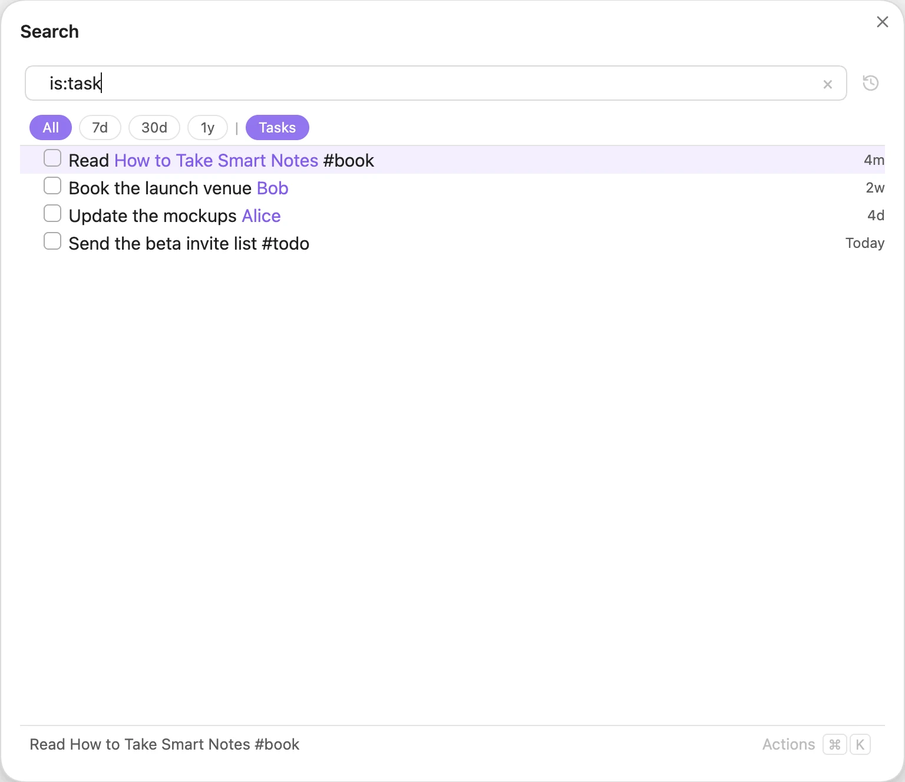
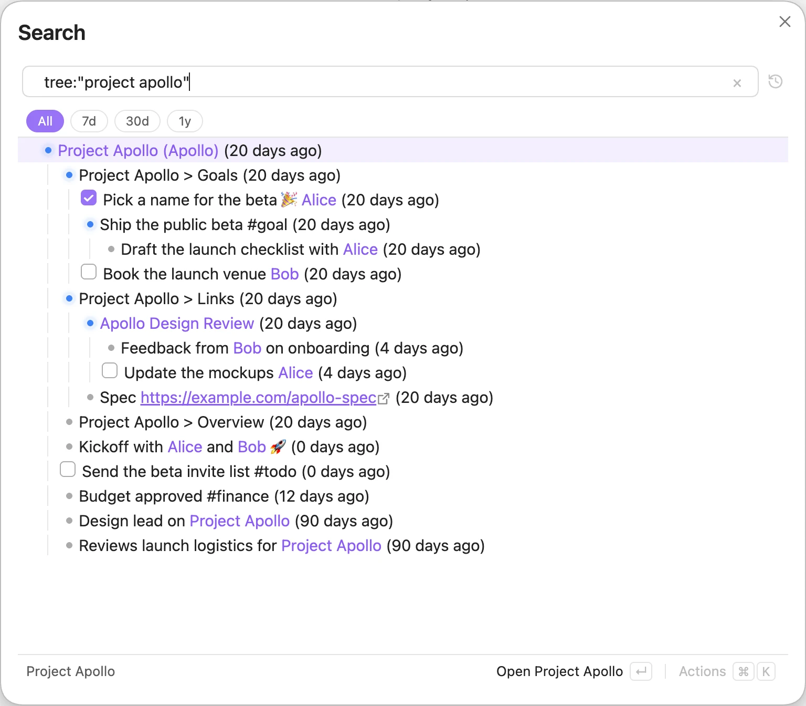
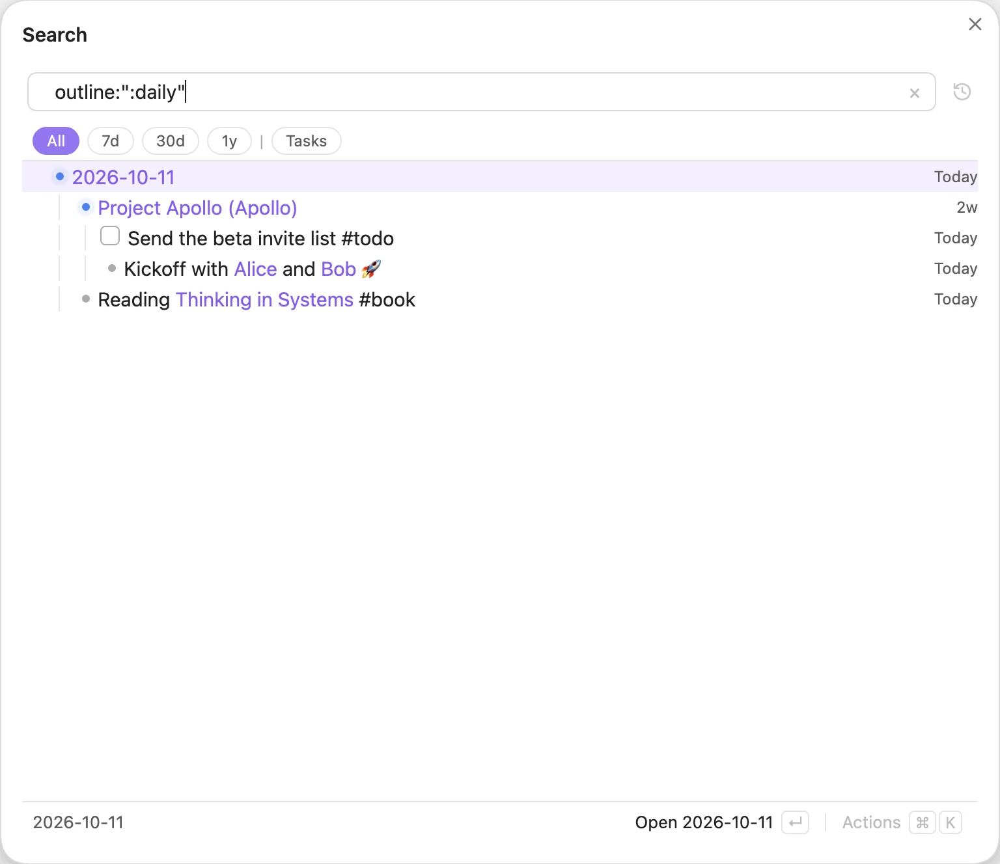

# Query language

A query is a list of words and filters. With no operators, every term must match. The tables below are the same cheat sheet you see in the plugin when the search box is empty.

Matching is case-insensitive: `apollo` finds "Project Apollo".

## Text

| Syntax | Meaning |
| --- | --- |
| `foo` | contains “foo” |
| `"foo bar"` | exact match |

## Type — is:

| Syntax | Meaning |
| --- | --- |
| `is:page` | notes / pages |
| `is:header` | headings |
| `is:text` | text & list lines |
| `is:folder` | folders |
| `is:attachment` | attachments |
| `is:task` | open tasks |
| `is:subtask` | open tasks nested under a line |
| `is:subtext` | lines nested under a line |
| `is:list` | lines with nested lines |
| `is:completed` | completed tasks |
| `is:undated` | no date |
| `is:archived` | reveal archived (greyed) |

*`is:task` lists every open task in the vault; done tasks are left out.*

## Content — has:

| Syntax | Meaning |
| --- | --- |
| `has:emoji` | has an emoji |
| `has:link` | has any link |
| `has:page` | has a page link |

## Recency — in:

| Syntax | Meaning |
| --- | --- |
| `in:7d` | last 7 days |
| `in:2w` | last 2 weeks |
| `in:1m` | last month |
| `in:1y` | last year |

## Scope — outline:, tree:

| Syntax | Meaning |
| --- | --- |
| `outline:<note>` | outline of the latest note matching &lt;note&gt; |
| `outline:"my note"` | outline of exactly “my note” |
| `tree:<note>` | latest note matching &lt;note&gt; with all its children, from any note |
| `tree:"my note"` | exactly “my note” with all its children, from any note |

`outline:` shows only what is written inside a note. `tree:` goes further and adds everything written about it anywhere in your vault.

*`tree:"project apollo"`: the note plus everything written about it anywhere.*

## Combine

| Syntax | Meaning |
| --- | --- |
| `a b` | AND — both |
| <code>a &#124; b</code> | OR — either |
| `-a` | NOT — exclude |
| <code>(a &#124; b) c</code> | grouping |
| `a . b` | stage — find a, then b beneath it |

Operators bind in this order, tightest first: NOT, then AND, then OR, then stage (`.`). Use parentheses when you need a different grouping.

The stage separator is `.` by default. You can change it in [Settings](panes-and-integrations.md#settings).

## Shortcuts

| Syntax | Meaning |
| --- | --- |
| `:page` | pages |
| `:header` | headings |
| `:folder` | folders |
| `:attachment` | attachments |
| `:task` | open tasks |
| `:subtask` | nested open tasks |
| `:subtext` | nested lines |
| `:list` | lines with nested lines |
| `:archived` | reveal archived (greyed) |
| `:emoji` | has an emoji |
| `:daily` | outline of today's daily note |

*`:daily` shows the outline of today's daily note.*
