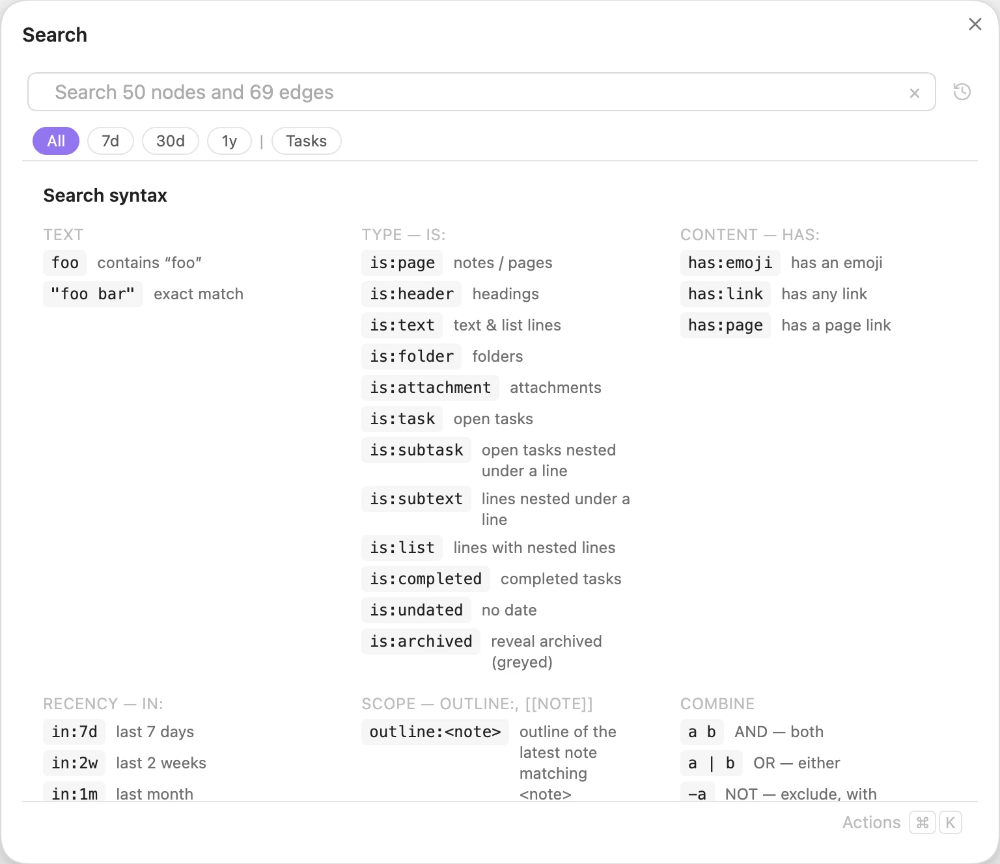
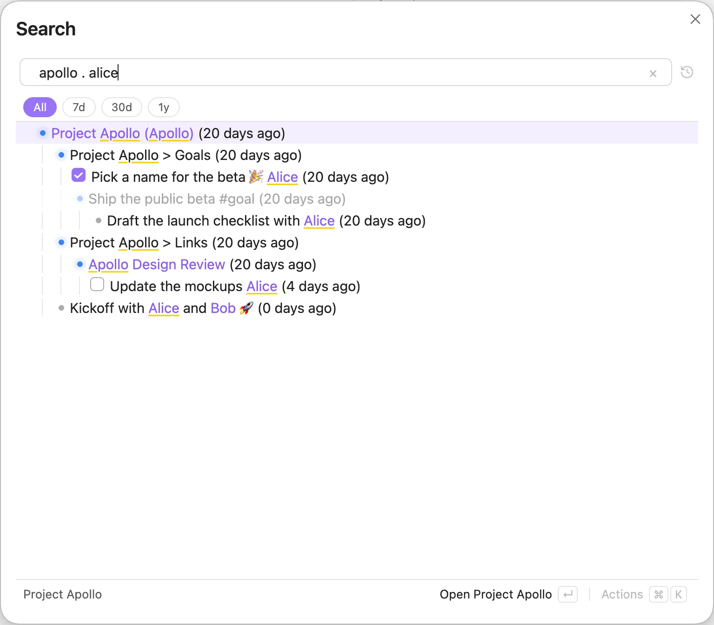
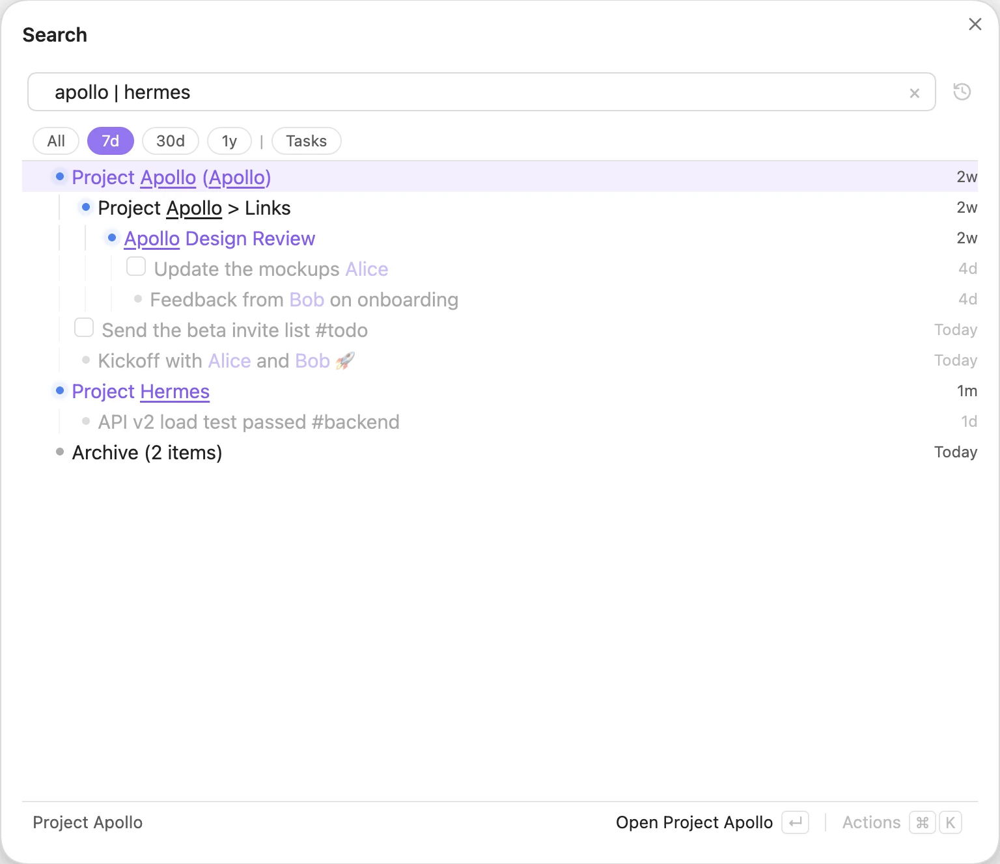
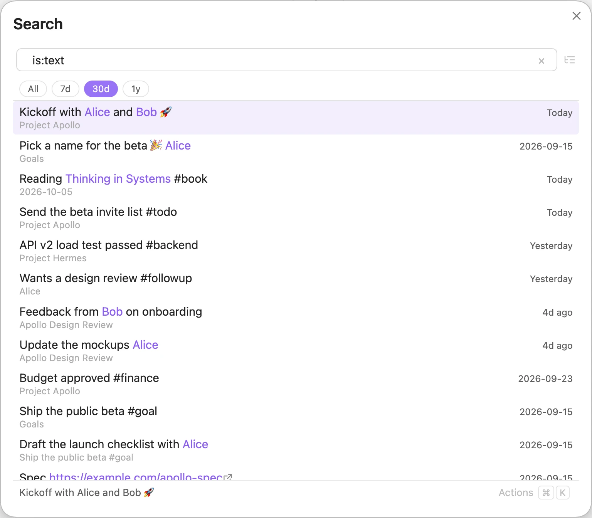
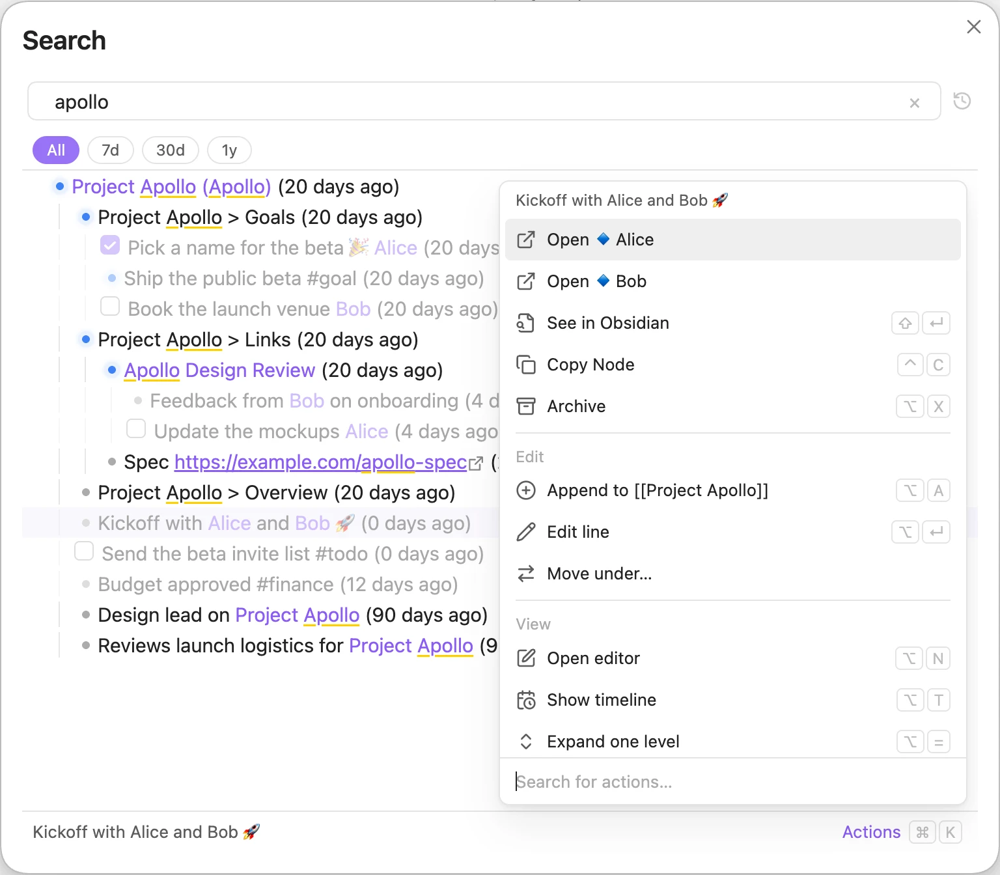

# Searching

There are three ways to search your tree:

- **Search modal.** Run the **Tree Search: Search** command. It opens over your work and closes when you pick a result.
- **Search pane.** Run **Tree Search: Search pane** to keep a search open in the sidebar while you write.
- **Quick Link.** Run **Tree Search: Quick Link** to search and insert a link at your cursor. See the [Editor](editor.md#quick-link) page.

## Start with an empty query

When the search box is empty, Tree Search shows the query syntax. Click any filter to add it to your query.

*An empty query shows the syntax; each filter is clickable.*

The full list is on the [Query language](query-language.md) page.

## Hierarchical search

Separate terms with a `.` to search down the tree. Tree Search finds the first term, then looks for the next one beneath it.

*`apollo . alice` finds Alice beneath Apollo.*

This is how you narrow a big topic to the part you care about, without remembering which note something was written in.

## Recency

The chips above the results limit them by date: **All**, **7d**, **30d** and **1y**. You can also press <kbd>Alt</kbd>+<kbd>1</kbd> to <kbd>Alt</kbd>+<kbd>4</kbd>. After the `|` come your filter pills. Clicking a pill adds its query to the search, or removes it when it is already there. **Tasks** (`is:task`) is there to start with.

To make your own pill, type a query, open the action panel and choose **Save as Filter** in its **Filter** section, then name the pill and press <kbd>Enter</kbd>. If a pill with that name already exists, the editor says so and **Save** becomes **Replace**, which gives that pill the new query in its place. While a pill is active, the same section offers **Delete Filter** for it (for example **Delete Filter "Tasks"**), which removes the pill and leaves the query as it is. **Tasks** can be deleted like any other pill.

In Tree mode, a recency chip prunes the tree to branches with recent activity.

Dated rows show how old they are on the right, in both Tree and Timeline mode: **Today**, then days (**1d** to **7d**), weeks (**1w** to **3w**), months (**1m** to **12m**), and the year (**2025**) once a row is more than 12 months old. Rows dated in the future show how far ahead they are: **Tomorrow**, the weekday (**Wed**) up to 6 days ahead, **Next Week** for the rest of next week (Monday to Sunday), **This Month**, the month (**Nov**) later this year, then the year (**2027**). Dates are calendar days in your time zone. Hover the date to see the full date; a date written in the line itself is not repeated in its text. Rows with an image show its thumbnail just before the date.

*<code>apollo &#124; hermes</code> with **7d**: only the branches touched in the last week remain.*

## Nested lines

A match on a nested line shows its whole outline block: the outermost line above it in its note, with all the lines under it. Lines that don't match are dimmed. A line with 4 or more nested lines shows the first 3 plus every line that matches, and a **+N more** control shows the rest. In the Tree the block shows as rows; in the Timeline it shows inside one row.

## Timeline

Switch to the Timeline with the toggle above the results, or press <kbd>Alt</kbd>+<kbd>T</kbd>. The Timeline shows your results as a flat list, newest first, so future-dated items come first, furthest ahead at the top. Open tasks are the exception (see [Tasks](#tasks)). Items with an emoji are pinned to the top. A line takes its date from its daily note, a date in the line, or its note's `created`/`updated` frontmatter; lines with none of these use the date their file was created.

*`is:text` in the Timeline with **30d**: dated rows, with emoji items pinned on top.*

## Actions

Select a row and press <kbd>Cmd/Ctrl</kbd>+<kbd>K</kbd>, or click **Actions**, to see what you can do with it. The list depends on the row. For a line, you can:

- open the notes it links to;
- see it in Obsidian;
- copy it;
- archive it;
- append under its note, edit it in place, or move it under another note.

Note rows add note actions, such as moving the note to a folder or consolidating notes into it. The panel also lists view actions (open the editor, switch to the Timeline, expand or collapse), and you can type to filter them.

For an open task, a **Task** section adds **Done**, **Today**, **Tomorrow**, **Weekend** (next Saturday) and **Next Week** (next Monday). See [Tasks](#tasks).

*The Actions panel for "Kickoff with Alice and Bob".*

## Tasks

Task lines (`- [ ] …`) show their checkbox in Tree and Timeline rows. Click it to complete the task in its note: the line becomes `- [x] …` and gets `[completion:: <today>]`. Completing a task also completes the open tasks nested under it. Click a completed task's checkbox to reopen it; its completion date is removed, and its subtasks stay as they are. The panel's **Today**, **Tomorrow**, **Weekend** and **Next Week** set the task's `[scheduled:: <date>]`, replacing an existing scheduled date (`[scheduled:: …]`, `(scheduled:: …)` or `⏳ …`); its subtasks keep their own dates. These fields use the [Tasks](https://publish.obsidian.md/tasks/) plugin's Dataview format. Recurring tasks don't get a next occurrence. If the note changed since it was indexed, nothing is written and you see "This row's index is out of date".

When you add lines with the editor, Quick Add or a search chain, every open task without a scheduled date gets `[scheduled:: <today>]`. When you edit a single line, an open task without a scheduled date gets it too, unless it is nested under another line.

A line with a scheduled or due date (`[scheduled:: …]`, `(due:: …)`, `⏳ …`, `📅 …`; the earliest when it has several) is dated by it, even when a `[created:: …]` comes first. Other lines use their first date. A task with open subtasks shows, and sorts by, the earliest date among its own date and its open subtasks' scheduled or due dates. A subtask's `[created:: …]` or other dates in its text never move the task's date. The note itself is not changed.

Open tasks sort oldest first, so overdue tasks come first and future ones last: in the Timeline, right after pinned items; in the Tree, before the other lines under the same parent. Undated open tasks come after the dated ones in the Tree. Completed tasks sort like any other line.

## Previews

Hold <kbd>Cmd/Ctrl</kbd> and hover over a result to preview the place where that line was written.

For every keyboard shortcut, see [Shortcuts](shortcuts.md).
