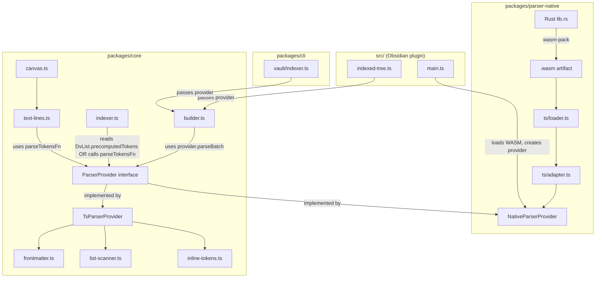

## Technical Approach

### Architecture

```
packages/
├── parser-native/                     # NEW — Rust WASM parser package
│   ├── Cargo.toml                     # Rust crate: lib type = cdylib, deps: serde, serde_json, regex-lite
│   ├── rust-toolchain.toml            # Pin stable Rust toolchain
│   ├── src/
│   │   ├── lib.rs                     # wasm-bindgen entry: batch_parse_chunk, parse_single, parse_tokens
│   │   ├── frontmatter.rs             # Full YAML parsing (all key-value pairs via serde_yaml or custom)
│   │   ├── list_scanner.rs            # scanMarkdown equivalent (header/list detection, indent stack)
│   │   ├── inline_tokens.rs           # parseTokens equivalent (obsidian links, md links, meta-actions)
│   │   ├── types.rs                   # Serde-serializable output structures mirroring DvPage/DvList
│   │   └── tests/                     # Rust unit tests (cargo test)
│   ├── pkg/                           # wasm-pack output (gitignored)
│   ├── ts/
│   │   ├── index.ts                   # Public API: loadNativeParser() → NativeParser instance
│   │   ├── adapter.ts                 # Deserializes WASM JSON output → @mdtree/core types
│   │   ├── loader.ts                  # WASM instantiation (inline bytes for plugin, file for CLI)
│   │   └── __tests__/
│   │       └── adapter.test.ts        # Adapter round-trip conformance tests
│   ├── package.json                   # @mdtree/parser-native workspace package
│   └── tsconfig.json
│
├── core/
│   └── src/
│       ├── parser/
│       │   ├── vault-file.ts          # UNCHANGED
│       │   ├── parser-provider.ts     # NEW — ParserProvider interface + TsParserProvider
│       │   ├── inline-tokens.ts       # UNCHANGED (still used as TS fallback)
│       │   ├── frontmatter.ts         # UNCHANGED
│       │   ├── list-scanner.ts        # UNCHANGED
│       │   ├── text-lines.ts          # MODIFIED — accepts optional parseTokensFn parameter
│       │   └── canvas.ts              # MODIFIED — threads parseTokensFn into buildNodesFromTextLines
│       ├── graph/
│       │   ├── types.ts               # MODIFIED — DvList gains optional precomputedTokens field
│       │   ├── builder.ts             # MODIFIED — accepts optional ParserProvider, chunked batch
│       │   ├── indexer.ts             # MODIFIED — uses precomputedTokens when present, falls back to parseTokensFn
│       │   └── ... (others unchanged)
│       └── index.ts                   # MODIFIED — re-exports ParserProvider type + createTsParserProvider
│
src/
│   ├── main.ts                        # MODIFIED — loads WASM, constructs ParserProvider, passes to IndexedTree
│   └── indexing/
│       └── indexed-tree.ts            # MODIFIED — accepts/passes ParserProvider to buildGraphFromScanner
```



### Key Decisions

1. **`DvList` gains an optional `precomputedTokens?: ParsedTextToken[]` field.** This is the core mechanism that resolves the batch API ambiguity. When the Rust batch parser processes a file, it runs `parseTokens` on every `rawText` internally (within the same WASM call) and attaches the result directly to the `DvList` output structure. The field is optional: when absent (TS parser path), `indexSinglePage` falls back to calling the `parseTokensFn` parameter. When present, it uses the pre-computed value with zero WASM boundary crossings.

2. **`DvPage` gains an optional `precomputedParentTokens?: Map<string, ParsedTextToken[]>` field.** The batch parser also pre-computes tokens for every frontmatter parent string. Keyed by the raw parent string value (e.g., `"[[Root]]"`). `indexSinglePage` at line 238 checks this map before calling `parseTokensFn`.

3. **The Rust `batch_parse_chunk` function's JSON output includes inline tokens for EVERY `DvList.rawText` AND every frontmatter parent string.** The JSON schema for a single file's output is:
   ```json
   {
     "file": { ... },
     "headers": [...],
     "precomputedParentTokens": { "[[Root]]": [...tokens...] },
     "file.lists.values[i].precomputedTokens": [...tokens...]
   }
   ```
   The TypeScript adapter deserializes this into `DvPage` with tokens attached. This means: **for batch-parsed .md files, `indexSinglePage` makes ZERO additional WASM calls.**

4. **`indexSinglePage` signature and token resolution logic.** The function signature becomes:
   ```typescript
   export function indexSinglePage(
     page: DvPage,
     graph: NotesGraph,
     settings: IndexSettings,
     parseTokensFn?: (text: string) => ParsedTextToken[],
   ): ParsedNode | undefined
   ```
   At line 53 (`createNodeFromText`), the logic is:
   ```
   const parsed = item.precomputedTokens ?? parseTokensFn(item.rawText)
   ```
   At line 238 (frontmatter parents), the logic is:
   ```
   const refs = graph.getObsidianLinkReferences(
     page.precomputedParentTokens?.get(parent) ?? parseTokensFn(parent)
   )
   ```
   The `parseTokensFn` parameter defaults to the existing TS `parseTokens` import when not provided.

5. **`ParserProvider` interface exposes three capabilities.** The interface defines: (a) `parseBatchChunk(files: FileInput[]) → DvPage[]` which returns `DvPage` with pre-computed tokens already attached, (b) `parseTokens(text: string) → ParsedTextToken[]` as a standalone callable for canvas/non-batch contexts, (c) `parseVaultFile(content, path, mtime, archiveTag) → DvPage` for single-file incremental reindex (also returns tokens pre-computed).

6. **Canvas path uses standalone `parseTokensFn`, NOT pre-computed tokens.** Canvas text lines are short strings from canvas node JSON, not vault file content. They go through `buildNodesFromTextLines` → `createTextNode` which calls `parseTokensFn(text)`. This is acceptable: canvas files typically have 10-50 text lines, so 10-50 individual WASM calls per canvas file is negligible. The `parseCanvasData` signature becomes `parseCanvasData(path, name, canvasData, graph, parseTokensFn?)`.

7. **Chunked batch processing (50-100 files per WASM call) with event-loop yielding.** `buildGraphFromScanner` when given a `ParserProvider`: reads file contents into chunks of configurable size (default 50). Per chunk: (a) call `provider.parseBatchChunk(chunk)` — one WASM boundary crossing returning all `DvPage` objects with pre-computed tokens, (b) iterate results and call `indexSinglePage(page, graph, settings)` per page — no `parseTokensFn` needed because `precomputedTokens` is populated, (c) `await setTimeout(0)` to yield the event loop.

8. **JSON serialization via `serde_json`.** WASM boundary crossing uses JSON. Batch output is a JSON array with nested token arrays already embedded. For standalone `parseTokens`, a single JSON array of tokens per call.

9. **New workspace package (`@mdtree/parser-native`) with no dependency from `@mdtree/core`.** Core does NOT depend on parser-native. The `ParserProvider` interface is defined IN core. The native implementation lives in parser-native. Consumers inject it.

10. **Full YAML frontmatter parsing in Rust (not lightweight).** Uses `serde_yaml` (or `yaml-rust2`) for complete YAML support, returning `Record<string, unknown>` equivalent.

11. **`parseTokens` state machine in Rust — no full markdown parser.** Hand-written state machine covering: obsidian `[[link|alias]]`, markdown `[text](url)`, images, HTTP URLs, text decorations, meta-action triples, meta-mdtree directives.

12. **wasm-pack `--target web` with custom loader.** The `web` target produces an init function accepting `BufferSource`. Plugin's `loader.ts` provides bytes directly (base64-decoded inline string from esbuild plugin). Works in mobile WebView and Bun.

### Integration Points

| Integration point | Current code | Change |
|---|---|---|
| `DvList` type | `packages/core/src/graph/types.ts` line 152-167 | ADD optional field: `precomputedTokens?: ParsedTextToken[]` |
| `DvPage` type | `packages/core/src/graph/types.ts` line 169-180 | ADD optional field: `precomputedParentTokens?: Map<string, ParsedTextToken[]>` |
| `ParserProvider` interface | Does not exist | NEW in `packages/core/src/parser/parser-provider.ts` |
| `TsParserProvider` | Does not exist | NEW in same file — implements interface using existing TS functions (does NOT set `precomputedTokens` — leaves undefined) |
| `NativeParserProvider` | Does not exist | NEW in `packages/parser-native/ts/index.ts` — implements interface, adapter attaches `precomputedTokens` to every `DvList` |
| `createNodeFromText()` | `indexer.ts:53` — `const parsed = parseTokens(item.rawText)` | Changes to: `const parsed = item.precomputedTokens ?? parseTokensFn(item.rawText)` |
| `indexSinglePage()` line 238 | `parseTokens(parent)` | Changes to: `page.precomputedParentTokens?.get(parent) ?? parseTokensFn(parent)` |
| `indexSinglePage()` signature | `(page, graph, settings)` | Becomes `(page, graph, settings, parseTokensFn?)` where default is imported TS `parseTokens` |
| `buildNodesFromTextLines()` | `text-lines.ts:82` — `const parsed = parseTokens(text)` | Accepts optional `parseTokensFn` parameter, uses it at line 82 |
| `createTextNode()` | Internal to `text-lines.ts` | Accepts optional `parseTokensFn`, defaults to TS `parseTokens` |
| `parseCanvasData()` | No parse function parameter | Accepts optional `parseTokensFn`, threads to `buildNodesFromTextLines` |
| `indexScannedFile()` in `builder.ts` | Calls `parseCanvasData` at line 40 | Passes `provider?.parseTokens` to `parseCanvasData` |
| `buildGraphFromScanner()` | Calls per-file, yields every 10 | Accepts optional `ParserProvider` + `chunkSize`. Batch path uses chunks; batch-produced `DvPage` objects carry pre-computed tokens so `indexSinglePage` never calls WASM individually |
| `reindexFileInGraph()` | Calls `indexScannedFile` | Accepts optional `ParserProvider`; for `.md`: uses `provider.parseVaultFile()` (returns pre-computed tokens); passes `provider.parseTokens` for canvas |
| `IndexedTree` | No provider concept | Constructor accepts `ParserProvider`; passes to `buildGraphFromScanner` and `reindexFileInGraph` |
| `TreeSearchPlugin.onload()` | Instantiates `IndexedTree` | Loads WASM (try/catch), creates `NativeParserProvider` or falls back to `TsParserProvider` |
| esbuild config | Bundles `src/` + `@mdtree/core` | Adds plugin: resolves `.wasm` → base64 string constant |
| CLI | Calls `buildGraphFromScanner` | Optionally loads WASM, creates provider, passes to builder |
| `@mdtree/core/index.ts` | Exports parser functions | Additionally exports `ParserProvider` type, `TsParserProvider`, `createTsParserProvider()` |

### `ParserProvider` Interface (Key Data Structure)

```typescript
// packages/core/src/parser/parser-provider.ts

import type { DvPage, ParsedTextToken } from "../graph/types.ts"

export type FileInput = {
  path: string
  content: string
  mtime: number
  archiveTag: string
}

export interface ParserProvider {
  /**
   * Parse a chunk of markdown files in one call.
   * Returns DvPage[] where EACH DvList item has `precomputedTokens` populated
   * and EACH DvPage has `precomputedParentTokens` populated.
   * This means consumers (indexSinglePage) make ZERO additional parseTokens calls
   * for batch-parsed files.
   */
  parseBatchChunk(files: FileInput[]): DvPage[]

  /**
   * Parse inline tokens from a single text string.
   * Used ONLY for canvas text lines and other non-batch contexts.
   * NOT called per-list-item during batch flow (tokens are pre-computed).
   */
  parseTokens(text: string): ParsedTextToken[]

  /**
   * Parse a single vault file (for incremental reindex).
   * Returns DvPage with precomputedTokens and precomputedParentTokens populated.
   */
  parseVaultFile(content: string, filePath: string, mtime: number, archiveTag: string): DvPage
}
```

### Extended `DvList` and `DvPage` Types

```typescript
// In packages/core/src/graph/types.ts — additions only

export type DvList = {
  // ... existing fields ...
  /**
   * Pre-computed ParsedTextToken[] for this item's rawText.
   * Populated by the native batch parser. When present, indexSinglePage
   * uses this directly instead of calling parseTokens(rawText).
   * Undefined when using the TS parser (tokens computed on-demand).
   */
  precomputedTokens?: ParsedTextToken[]
}

export type DvPage = {
  // ... existing fields ...
  /**
   * Pre-computed tokens for frontmatter parent strings.
   * Keys are the raw parent string values (e.g., "[[Root]]").
   * Populated by the native batch parser. When present, indexSinglePage
   * uses this instead of calling parseTokens(parent).
   * Undefined when using the TS parser.
   */
  precomputedParentTokens?: Map<string, ParsedTextToken[]>
}
```

### Revised `indexSinglePage` Token Resolution (Pseudocode)

```typescript
// createNodeFromText — line 53 change:
function createNodeFromText(
  graph: NotesGraph,
  page: DvPage,
  item: DvList,
  parseTokensFn: (text: string) => ParsedTextToken[] = parseTokens,
): ParsedNode {
  // Use pre-computed tokens from batch if available; otherwise call parseTokensFn
  const parsed = item.precomputedTokens ?? parseTokensFn(item.rawText)
  // ... rest unchanged ...
}

// indexSinglePage — line 238 change:
for (const parent of parents as string[]) {
  // Use pre-computed parent tokens from batch if available; otherwise call parseTokensFn
  const tokens = page.precomputedParentTokens?.get(parent) ?? parseTokensFn(parent)
  const refs = graph.getObsidianLinkReferences(tokens)
  // ... rest unchanged ...
}
```

### Revised `buildGraphFromScanner` with Batch Flow

```typescript
export async function buildGraphFromScanner(
  scanner: VaultScanner,
  settings: IndexSettings = DEFAULT_SETTINGS,
  provider?: ParserProvider,
  chunkSize = 50,
): Promise<NotesGraph> {
  const graph = new NotesGraph()
  const { files, folders } = await scanner.walkVault()

  // Folder nodes (unchanged)
  for (const folder of folders) { /* ... */ }

  if (provider) {
    // BATCH PATH: group .md files, process in chunks
    const mdFiles: { path: string; content: string; mtime: number }[] = []
    const otherFiles: typeof files = []

    for (const file of files) {
      const ext = extname(file.path)
      if (ext === ".md") {
        const { content, mtime } = await scanner.readFile(file.path)
        mdFiles.push({ path: file.path, content, mtime })
      } else {
        otherFiles.push(file)
      }
    }

    // Process .md files in chunks
    for (let i = 0; i < mdFiles.length; i += chunkSize) {
      const chunk = mdFiles.slice(i, i + chunkSize)
      const input: FileInput[] = chunk.map(f => ({
        path: f.path, content: f.content, mtime: f.mtime, archiveTag: settings.archiveTag,
      }))

      // ONE WASM call per chunk — returns DvPage[] with all tokens pre-computed
      const pages = provider.parseBatchChunk(input)

      for (const page of pages) {
        // No parseTokensFn needed — precomputedTokens is populated on each DvList
        indexSinglePage(page, graph, settings)
      }

      await new Promise<void>(resolve => setTimeout(resolve, 0)) // yield
    }

    // Process canvas/other files individually
    for (const file of otherFiles) {
      const { content, mtime } = await scanner.readFile(file.path)
      // Canvas files use provider.parseTokens for their text lines
      await indexScannedFile(file.path, content, mtime, graph, settings, provider.parseTokens)
      await new Promise<void>(resolve => setTimeout(resolve, 0))
    }
  } else {
    // FALLBACK PATH: unchanged file-by-file behavior
    for (let i = 0; i < files.length; i++) {
      if (i % BATCH_SIZE === 0) await new Promise<void>(resolve => setTimeout(resolve, 0))
      const file = files[i]
      const { content, mtime } = await scanner.readFile(file.path)
      await indexScannedFile(file.path, content, mtime, graph, settings)
    }
  }

  return graph
}
```

### WASM Boundary Crossing Analysis (Explicit)

For a 2,000-note vault with ~20 list items per note and ~1.5 parent strings per note:

| Flow | Without pre-computed tokens | With pre-computed tokens |
|------|------|------|
| Batch parse (WASM calls) | 40 chunks × 1 = **40 calls** | 40 chunks × 1 = **40 calls** |
| Per-list-item `parseTokens` | 40,000 individual WASM calls | **0** (reads `precomputedTokens`) |
| Per-parent-string `parseTokens` | 3,000 individual WASM calls | **0** (reads `precomputedParentTokens`) |
| Canvas `parseTokens` (10 canvas files, ~30 lines each) | 300 individual WASM calls | 300 individual WASM calls (acceptable) |
| **Total WASM boundary crossings** | **~43,340** | **~340** |

This 127× reduction in boundary crossings is the primary mechanism for achieving the 3× parse-phase speedup target.

### WASM JSON Output Schema (Batch)

```json
[
  {
    "file": {
      "aliases": { "values": ["alias1"] },
      "name": "my-note",
      "mtime": { "ts": 1700000000000 },
      "path": "folder/my-note.md",
      "frontmatter": { "parent": "[[Root]]", "tags": ["work"] },
      "lists": {
        "values": [
          {
            "link": { "path": "folder/my-note.md" },
            "text": "some text",
            "rawText": "some text (meta-action-name::X)(meta-action-url::Y)",
            "line": 5,
            "position": { "start": { "line": 5, "col": 2 }, "end": { "line": 5, "col": 60 } },
            "parent": null,
            "children": [],
            "tags": ["#work"],
            "section": { "subpath": "Tasks" },
            "task": true,
            "completed": false,
            "precomputedTokens": [
              { "tokenType": "text", "text": "some text ", "decoration": "none" },
              { "tokenType": "meta_action", "name": "X", "url": "Y" }
            ]
          }
        ]
      },
      "tags": ["work"]
    },
    "headers": [...],
    "precomputedParentTokens": {
      "[[Root]]": [
        { "tokenType": "obsidian_link", "source": "[[Root]]", "pageTarget": "Root" }
      ]
    }
  }
]
```

## Risks

- **WASM binary size exceeds 2 MB compressed.** `serde_yaml` for full YAML parsing adds significant size. Mitigation: measure after adding dep; if over budget, use `unsafe-libyaml` (smaller); enable LTO + `wasm-opt -Oz`; strip debug info; gate CI on compressed size.

- **Behavioral divergence between Rust and TS parsers.** Subtle regex/unicode differences or markdown-it edge cases could produce different tokens. Mitigation: conformance test suite comparing `DvPage` deep equality (including `precomputedTokens`) against TS output for all fixtures; property-based fuzzing.

- **WASM instantiation failure on Obsidian mobile.** Some WebView versions restrict inline WASM. Mitigation: `WebAssembly.instantiate(bytes)` (not streaming); try/catch at load time; fall back to `TsParserProvider`; console.warn.

- **JSON serialization overhead for batch output with embedded tokens.** Each chunk's JSON now includes token arrays for every list item, significantly increasing response size. For 50 files × 20 items × ~200 bytes/token-array ≈ ~200KB per chunk. Mitigation: this is manageable on mobile; benchmark; if too large, reduce chunk size; tokens are small arrays (typically 2-5 elements).

- **Memory pressure from pre-computed tokens in `DvPage` objects.** Each `DvPage` now carries token arrays that persist until after `indexSinglePage` processes the item. For one chunk of 50 files, this is 50×20 = 1000 token arrays in memory simultaneously. Mitigation: GC reclaims after each chunk is processed and `pages` array is released; chunk size is configurable.

- **`serde_yaml` may not match `js-yaml` edge cases.** Different YAML parsers interpret ambiguous values differently. Mitigation: conformance test suite with varied YAML frontmatter; document divergences; targeted tests for `tags`, `aliases`, parent fields.

- **Build toolchain complexity (Rust + wasm-pack).** Developers need Rust toolchain. Mitigation: commit built `.wasm` to repo; non-Rust contributors use committed binary; CI rebuilds and validates.

- **esbuild base64 WASM inline increases bundle size ~33%.** Mitigation: Obsidian gzip distribution negates most overhead; alternatively use compressed WASM + `DecompressionStream` at load time.

- **Optional `precomputedTokens` field on `DvList` adds complexity to type.** Every consumer must handle both cases. Mitigation: only `indexSinglePage` reads this field; all other code treats `DvList` as before; the field is additive/backward-compatible.

- **Event-loop yielding between chunks adds latency on desktop.** ~4ms per yield × 40 chunks = ~160ms overhead. Mitigation: CLI uses larger chunk sizes (200-500) or skips yielding; yielding is primarily for mobile UI responsiveness.

## Refined Acceptance Criteria

Updated criteria (changes from previous iteration in bold):

- `packages/parser-native/` builds a `.wasm` artifact from Rust source
- WASM parser produces structurally identical output (deep equality) to TS parser for all existing integration test fixtures
- All existing tests pass with native parser active, and all pass with fallback to TS parser
- Plugin bundle includes and loads the WASM artifact at runtime
- Plugin loads and indexes on Obsidian mobile (iOS 16+, Android WebView 91+) via inline WASM
- Parse-phase-only indexing of a 2,000-note vault is at least 3x faster with WASM vs TS
- Incremental single-file reindex shows at least 2x parse-phase speedup
- Batch API processes files in chunks (50-100 per WASM call), yielding between chunks
- **Batch API output populates `DvList.precomputedTokens` for EVERY list item's `rawText` AND `DvPage.precomputedParentTokens` for EVERY frontmatter parent string — computed inside a single WASM call per chunk**
- **`indexSinglePage` resolves tokens via `item.precomputedTokens ?? parseTokensFn(item.rawText)` at line 53 and `page.precomputedParentTokens?.get(parent) ?? parseTokensFn(parent)` at line 238**
- **For a 2,000-note vault batch flow, graph construction makes ZERO individual `parseTokens` WASM calls for .md files (all tokens come from pre-computed fields)**
- **Benchmark harness measures total WASM boundary crossings during indexing and asserts the count equals `ceil(mdFileCount / chunkSize) + canvasTokenCalls` (no per-list-item crossings)**
- WASM compressed size under 2 MB
- `@mdtree/core` remains I/O-free; WASM loading injected by consumers
- `ParserProvider` exposes standalone `parseTokens(text)` for canvas text lines and ad-hoc non-batch contexts
- Rust `parseTokens` produces identical `ParsedTextToken[]` for all fixture `rawText` values
- Rust frontmatter parser emits all YAML key-value pairs (not just hardcoded fields)
- Canvas files with obsidian links in text nodes produce identical graph structures using native vs TS parser
- Frontmatter parent strings containing obsidian links produce identical graph edges using native vs TS parser
- Chunk size is configurable per consumer (default 50 for plugin, configurable for CLI)
- `parseCanvasData` accepts and uses `parseTokensFn` from the provider
- Core uses strategy pattern — `ParserProvider` injected as parameter, not conditional `import()`; TS fallback is default
- On desktop (Bun CLI), full-vault indexing with WASM parser is not slower than TS parser
- Graceful fallback on WASM load failure — console warning, no crash
- Rust source has its own independent test suite