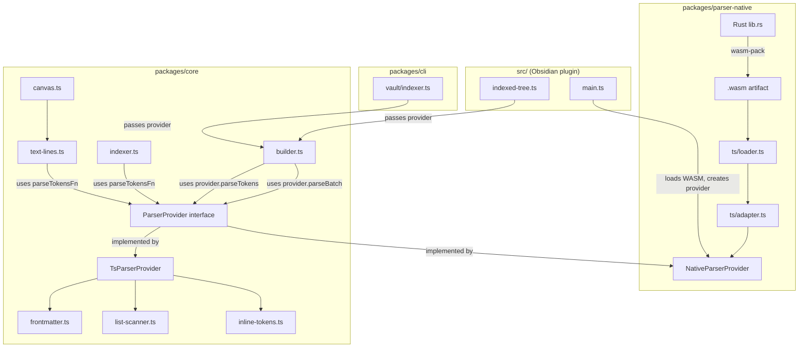

## Technical Approach

### Architecture

```
packages/
├── parser-native/                     # NEW — Rust WASM parser package
│   ├── Cargo.toml                     # Rust crate: lib type = cdylib, deps: serde, serde_json, regex-lite
│   ├── rust-toolchain.toml            # Pin stable Rust toolchain
│   ├── src/
│   │   ├── lib.rs                     # wasm-bindgen entry: batch_parse_chunk, parse_single, parse_tokens
│   │   ├── frontmatter.rs             # Full YAML parsing (all key-value pairs via serde_yaml or custom)
│   │   ├── list_scanner.rs            # scanMarkdown equivalent (header/list detection, indent stack)
│   │   ├── inline_tokens.rs           # parseTokens equivalent (obsidian links, md links, meta-actions)
│   │   ├── types.rs                   # Serde-serializable output structures mirroring DvPage/DvList
│   │   └── tests/                     # Rust unit tests (cargo test)
│   ├── pkg/                           # wasm-pack output (gitignored)
│   ├── ts/
│   │   ├── index.ts                   # Public API: loadNativeParser() → NativeParser instance
│   │   ├── adapter.ts                 # Deserializes WASM JSON output → @mdtree/core types
│   │   ├── loader.ts                  # WASM instantiation (inline bytes for plugin, file for CLI)
│   │   └── __tests__/
│   │       └── adapter.test.ts        # Adapter round-trip conformance tests
│   ├── package.json                   # @mdtree/parser-native workspace package
│   └── tsconfig.json
│
├── core/
│   └── src/
│       ├── parser/
│       │   ├── vault-file.ts          # UNCHANGED
│       │   ├── parser-provider.ts     # NEW — ParserProvider interface + TsParserProvider
│       │   ├── inline-tokens.ts       # UNCHANGED (still used as TS fallback)
│       │   ├── frontmatter.ts         # UNCHANGED
│       │   ├── list-scanner.ts        # UNCHANGED
│       │   ├── text-lines.ts          # MODIFIED — accepts optional parseTokensFn parameter
│       │   └── canvas.ts              # MODIFIED — threads parseTokensFn into buildNodesFromTextLines
│       ├── graph/
│       │   ├── builder.ts             # MODIFIED — accepts optional ParserProvider, chunked batch
│       │   ├── indexer.ts             # MODIFIED — accepts optional parseTokensFn for standalone calls
│       │   └── ... (others unchanged)
│       └── index.ts                   # MODIFIED — re-exports ParserProvider type + createTsParserProvider
│
src/
│   ├── main.ts                        # MODIFIED — loads WASM, constructs ParserProvider, passes to IndexedTree
│   └── indexing/
│       └── indexed-tree.ts            # MODIFIED — accepts/passes ParserProvider to buildGraphFromScanner
```



### Key Decisions

1. **`ParserProvider` interface exposes three capabilities, not just batch.** The interface defines: (a) `parseBatchChunk(files: FileInput[]) → DvPage[]` for bulk markdown parsing, (b) `parseTokens(text: string) → ParsedTextToken[]` as a standalone callable for any call site, (c) `parseVaultFile(content, path, mtime, archiveTag) → DvPage` for single-file incremental reindex. This addresses the critical finding that `parseTokens` is called at `indexer.ts:238` (frontmatter parents), `text-lines.ts:82` (canvas nodes), and `indexer.ts:53` (list items in non-batch flow).

2. **`parseTokensFn` threading pattern for leaf call sites.** Rather than making `indexSinglePage` and `buildNodesFromTextLines` accept the full `ParserProvider`, they accept an optional `parseTokensFn?: (text: string) => ParsedTextToken[]` parameter. This is cleaner for functions that only need token parsing, keeps their signatures simple, and avoids coupling graph construction to the batch concept. `builder.ts` extracts `provider.parseTokens` and passes it down.

3. **Chunked batch processing (50-100 files per WASM call) with event-loop yielding.** The `buildGraphFromScanner` function, when given a `ParserProvider`, reads file contents into chunks of configurable size (default 50). For each chunk: (a) call `provider.parseBatchChunk(chunk)` — one WASM boundary crossing, (b) iterate resulting `DvPage[]` and call `indexSinglePage` per page, (c) `await setTimeout(0)` to yield the event loop. This directly preserves the existing yield pattern from `builder.ts:69-70` while batching WASM calls. Memory is bounded to one chunk's worth of content + parsed output at a time.

4. **JSON serialization via `serde_json`.** WASM boundary crossing uses JSON (`serde_json::to_string` → `JSON.parse`). The batch API returns a single JSON array per chunk. For standalone `parseTokens`, a single JSON array of tokens is returned per call. This is debuggable, sufficient given amortized batch overhead, and avoids binary format dependencies.

5. **New workspace package (`@mdtree/parser-native`) with no dependency from `@mdtree/core`.** Core does NOT depend on parser-native. The `ParserProvider` interface is defined IN core, but the native implementation lives in parser-native. Consumers (plugin, CLI) create the provider and inject it. Core's fallback `TsParserProvider` wraps the existing TS functions.

6. **Full YAML frontmatter parsing in Rust (not lightweight).** The Rust frontmatter parser must handle all YAML structures (scalars, arrays, nested objects) and return a full `Record<string, unknown>` equivalent (`serde_json::Value` serialized as JSON). This addresses the finding that `parentRelation` is user-configurable — the parser cannot know which fields are needed. Using `serde_yaml` (or `yaml-rust2`) in Rust handles this correctly. WASM size impact is mitigated by `wasm-opt -Oz` and LTO.

7. **`parseTokens` state machine in Rust — no full markdown parser.** The inline token parser uses a hand-written state machine covering: obsidian `[[link|alias]]` with header syntax, markdown `[text](url)`, images ``, HTTP URL detection, text decorations (bold/italic/strikethrough/code), meta-action triples, and meta-mdtree directives. This matches the exact subset parsed by the current `markdown-it` + plugins approach without pulling a full markdown library into WASM.

8. **wasm-pack `--target web` with custom loader bypassing glue code.** The `web` target produces an init function that accepts a `BufferSource`. The plugin's `loader.ts` provides the WASM bytes directly (base64-decoded from an inlined string built by an esbuild plugin), bypassing any `fetch()` call. This works in both mobile WebView and Node/Bun. The esbuild config adds a custom plugin that reads `.wasm` → base64 string literal.

9. **Canvas path uses `parseTokensFn`, not batch.** `parseCanvasData` → `buildNodesFromTextLines` → `createTextNode` calls `parseTokens` on individual text strings. These are NOT batched (canvas nodes produce short text lines, not full file contents). Instead, `buildNodesFromTextLines` accepts an optional `parseTokensFn` parameter. When native parser is available, this is `provider.parseTokens`; otherwise, it falls back to the TS `parseTokens` function.

10. **`indexSinglePage` receives `parseTokensFn` for two call sites.** `createNodeFromText` at line 53 uses it for `item.rawText`, and line 238 uses it for frontmatter parent strings. The function signature becomes `indexSinglePage(page, graph, settings, parseTokensFn?)` where `parseTokensFn` defaults to the TS `parseTokens` import.

### Integration Points

| Integration point | Current code | Change |
|---|---|---|
| `ParserProvider` interface | Does not exist | NEW in `packages/core/src/parser/parser-provider.ts` — defines `parseBatchChunk`, `parseTokens`, `parseVaultFile` |
| `TsParserProvider` | Does not exist | NEW in same file — implements interface using existing TS functions |
| `buildGraphFromScanner()` | Calls `parseVaultFile` per file, yields every 10 | Accepts optional `ParserProvider` + `chunkSize`. When provider given: reads chunk of files → `provider.parseBatchChunk()` → index each result → yield → next chunk. When no provider: unchanged behavior |
| `reindexFileInGraph()` | Calls `parseVaultFile` inside `indexScannedFile` | Accepts optional `ParserProvider`; uses `provider.parseVaultFile()` for `.md` files; passes `provider.parseTokens` to `indexSinglePage` |
| `indexSinglePage()` | Imports and calls `parseTokens` directly at lines 53 and 238 | Accepts optional `parseTokensFn` parameter, defaults to imported `parseTokens`. Used at both `createNodeFromText` (line 53) and frontmatter parent parsing (line 238) |
| `buildNodesFromTextLines()` | Imports and calls `parseTokens` at `text-lines.ts:82` | Accepts optional `parseTokensFn` parameter, defaults to imported `parseTokens`. Passed into `createTextNode` |
| `parseCanvasData()` | Calls `buildNodesFromTextLines` without parse function | Accepts optional `parseTokensFn`, threads it to `buildNodesFromTextLines` |
| `indexScannedFile()` (internal to builder) | Calls `parseCanvasData` at line 40 | Passes `parseTokensFn` from the provider to `parseCanvasData` |
| `IndexedTree.refresh()` | Creates scanner, calls `buildGraphFromScanner` | Receives `ParserProvider` (injected from `main.ts`), passes to `buildGraphFromScanner` |
| `IndexedTree.refreshPage()` | Calls `reindexFileInGraph` | Passes `ParserProvider` to `reindexFileInGraph` |
| `TreeSearchPlugin.onload()` | Instantiates `IndexedTree` | Loads WASM (try/catch), creates `NativeParserProvider` or falls back to `TsParserProvider`, passes to `IndexedTree` constructor |
| `esbuild.config.mjs` | Bundles `src/` + `@mdtree/core` | Adds custom plugin: resolves `.wasm` imports → reads file → emits base64 string constant |
| CLI `buildGraph()` | Calls `buildGraphFromScanner` | Optionally loads WASM from filesystem, creates provider, passes to `buildGraphFromScanner` |
| `@mdtree/core/index.ts` | Exports parser functions | Additionally exports `ParserProvider` type, `TsParserProvider`, `createTsParserProvider()` |

### `ParserProvider` Interface (Key Data Structure)

```typescript
// packages/core/src/parser/parser-provider.ts

import type { DvPage, ParsedTextToken } from "../graph/types.ts"

export type FileInput = {
  path: string
  content: string
  mtime: number
  archiveTag: string
}

export interface ParserProvider {
  /** Parse a chunk of markdown files in one call. Returns DvPage per file. */
  parseBatchChunk(files: FileInput[]): DvPage[]

  /** Parse inline tokens from a text string. Usable standalone. */
  parseTokens(text: string): ParsedTextToken[]

  /** Parse a single vault file (equivalent to parseVaultFile). */
  parseVaultFile(content: string, filePath: string, mtime: number, archiveTag: string): DvPage
}
```

### Revised `buildGraphFromScanner` Signature

```typescript
export async function buildGraphFromScanner(
  scanner: VaultScanner,
  settings: IndexSettings = DEFAULT_SETTINGS,
  provider?: ParserProvider,
  chunkSize?: number,  // default 50
): Promise<NotesGraph>
```

When `provider` is supplied:
1. Walk vault, collect files and folders
2. Create folder nodes (unchanged)
3. Partition files into `.md`, `.canvas`, and other
4. For `.md` files: read contents in chunks of `chunkSize`, call `provider.parseBatchChunk(chunk)`, then `indexSinglePage(page, graph, settings, provider.parseTokens)` per result, yield between chunks
5. For `.canvas` files: process one at a time, calling `parseCanvasData(path, name, canvasData, graph, provider.parseTokens)`
6. For other files: unchanged (`addAttachmentNode`)

When `provider` is NOT supplied: existing behavior (file-by-file with yield every 10).

### WASM API Surface (Rust → JS)

```rust
// packages/parser-native/src/lib.rs

#[wasm_bindgen]
pub fn batch_parse_chunk(json_input: &str) -> String {
    // Input: JSON array of {path, content, mtime, archiveTag}
    // Output: JSON array of DvPage-equivalent structures
}

#[wasm_bindgen]
pub fn parse_tokens(text: &str) -> String {
    // Input: raw text string
    // Output: JSON array of ParsedTextToken-equivalent structures
}

#[wasm_bindgen]
pub fn parse_single(content: &str, path: &str, mtime: f64, archive_tag: &str) -> String {
    // Input: single file parameters
    // Output: JSON DvPage-equivalent structure
}
```

## Risks

- **WASM binary size exceeds 2 MB compressed.** Pulling `serde_yaml` (or `yaml-rust2`) for full YAML parsing adds significant size. Mitigation: measure size after adding YAML dep; if over budget, use `unsafe-libyaml` (Rust binding to libyaml, smaller than pure Rust); enable LTO + `wasm-opt -Oz`; strip debug info; gate CI on compressed size.

- **Behavioral divergence between Rust and TS parsers.** Subtle regex/unicode differences or markdown-it edge cases could produce different graph structures. Mitigation: run ALL existing integration test fixtures through both parsers and assert deep equality on the produced `DvPage` structures; add a conformance test that generates `parseTokens` output for every `rawText` in fixtures and compares against TS output; use property-based fuzzing for edge cases.

- **WASM instantiation failure on Obsidian mobile.** Some mobile WebView versions restrict inline WASM or have memory limits. Mitigation: use `WebAssembly.instantiate(bytes)` (not streaming); wrap in try/catch at load time; fall back to `TsParserProvider` silently with `console.warn`; test on iOS 16+ and Android WebView 91+.

- **JSON serialization overhead for standalone `parseTokens` calls.** Each standalone call crosses the WASM boundary with JSON. For canvas nodes or frontmatter parents, this is many small calls. Mitigation: for canvas, batch all text lines from a single canvas node into one `parseTokens` call (modify `createTextNode` to accept pre-parsed tokens); for frontmatter parents (short strings, typically 1-3 per file), overhead is negligible; benchmark to confirm net positive.

- **Memory pressure on mobile from chunked batch.** Even with chunks of 50 files, each chunk holds ~50 file contents (average ~5KB each = ~250KB) plus JSON output. This is modest. Mitigation: make chunk size configurable; default 50 for plugin (mobile), allow larger for CLI; document memory characteristics.

- **`serde_yaml` full YAML parsing may not match `js-yaml` edge cases.** Different YAML parsers can interpret ambiguous values differently (e.g., `yes`/`no` as booleans). Mitigation: the conformance test suite must include frontmatter with varied YAML features; document any known divergences; for the fields that matter (`tags`, `aliases`, parent relation), add targeted tests.

- **Build toolchain complexity (Rust + wasm-pack in CI and locally).** Developers must install Rust toolchain to rebuild WASM. Mitigation: commit the built `.wasm` to the repo (or store as npm artifact); non-Rust contributors use the committed binary; CI rebuilds and validates it matches; Rust build is isolated to `packages/parser-native/`.

- **esbuild CJS format + WASM inline base64 bundle size.** Inlining a 1-2 MB WASM as base64 increases the JS bundle by ~33% (base64 overhead). Mitigation: gzip compression in Obsidian's plugin distribution negates most overhead; alternatively, use compressed bytes (e.g., gzipped WASM in base64 + `DecompressionStream` at load time) if bundle size is a concern.

- **Event-loop yielding between chunks may slow overall indexing on desktop.** Each `setTimeout(0)` adds ~4ms latency on some engines. For 40 chunks (2000 files / 50), that's ~160ms overhead. Mitigation: on desktop/CLI, use larger chunk sizes (200-500) or skip yielding entirely; the yielding is primarily important for mobile UI responsiveness.

## Refined Acceptance Criteria

The original acceptance criteria from the revised proposal (step 5) are comprehensive. The following refinements address gaps revealed by the detailed integration analysis:

1. **Canvas path coverage (addresses Critical finding #1).** The `ParserProvider.parseTokens` function is used by `buildNodesFromTextLines` for canvas text lines. Add criterion: "Canvas files with obsidian links in text nodes produce identical graph structures whether using native or TS parser." This ensures the canvas-specific `parseTokens` call site at `text-lines.ts:82` is tested.

2. **Frontmatter parent `parseTokens` coverage (addresses Critical finding #2).** Add criterion: "Frontmatter parent strings containing obsidian links (e.g., `parent: '[[Root]]'`) produce identical graph edges whether using native or TS parser." This ensures `indexer.ts:238` is covered.

3. **Chunk size configurability (addresses Warning: memory pressure + event loop).** Add criterion: "The batch chunk size is configurable per consumer (default 50 for plugin, configurable for CLI) and event-loop yielding occurs between chunks."

4. **`parseCanvasData` integration (addresses Warning: canvas not in integration table).** Add criterion: "`parseCanvasData` accepts and uses the `parseTokensFn` from the provider, threading it through to `buildNodesFromTextLines`."

5. **No conditional imports in core (addresses Warning: proposal contradicting design).** Clarify: "Core uses the strategy pattern — `ParserProvider` is injected as a parameter, not loaded via conditional `import()`. The TS fallback is the default when no provider is passed."

6. **Desktop/CLI performance not regressed.** Add criterion: "On desktop (Bun CLI), full-vault indexing with WASM parser is not slower than TS parser (it should be faster; yielding overhead must not cause regression)."