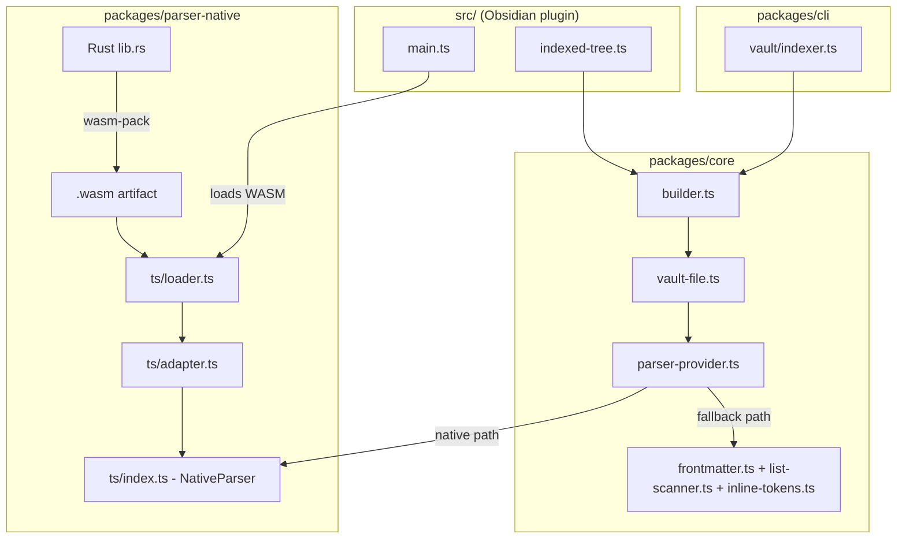

## Technical Approach

### Architecture

```
packages/
├── parser-native/                     # NEW — Rust WASM parser package
│   ├── Cargo.toml                     # Rust crate config (lib type = cdylib)
│   ├── rust-toolchain.toml            # Pin stable Rust toolchain
│   ├── src/
│   │   ├── lib.rs                     # wasm-bindgen entry: batch_parse, parse_single
│   │   ├── frontmatter.rs             # YAML boundary detection + key extraction
│   │   ├── list_scanner.rs            # scanMarkdown equivalent (header/list detection)
│   │   ├── inline_tokens.rs           # parseTokens equivalent (obsidian links, md links)
│   │   ├── types.rs                   # Serde-serializable output structures
│   │   └── tests/                     # Rust unit tests (cargo test)
│   ├── pkg/                           # wasm-pack output (gitignored except committed .wasm)
│   ├── ts/
│   │   ├── index.ts                   # Public API: loadNativeParser(), NativeParser interface
│   │   ├── adapter.ts                 # Deserializes WASM JSON output → @mdtree/core types
│   │   ├── loader.ts                  # WASM module loading (inline bytes vs fetch)
│   │   └── __tests__/
│   │       └── adapter.test.ts        # Adapter round-trip tests
│   ├── package.json                   # @mdtree/parser-native workspace package
│   └── tsconfig.json
│
├── core/
│   └── src/
│       ├── parser/
│       │   ├── vault-file.ts          # MODIFIED — accepts optional NativeParser
│       │   ├── parser-provider.ts     # NEW — strategy pattern: native or TS parser
│       │   └── ... (existing files unchanged)
│       └── index.ts                   # MODIFIED — re-exports parser-provider
│
src/
│   ├── main.ts                        # MODIFIED — loads WASM on plugin init
│   └── indexing/
│       └── indexed-tree.ts            # MODIFIED — passes parser to buildGraphFromScanner
```



### Key Decisions

1. **Serialization format: JSON over shared memory buffers.** The WASM boundary crossing will use JSON serialization (via `serde_json` in Rust, `JSON.parse` in JS). While MessagePack or FlatBuffers would be faster for deserialization, JSON is debuggable, the overhead is small relative to parse time, and it avoids introducing a binary format dependency. The batch API amortizes the per-call overhead.

2. **New workspace package (`@mdtree/parser-native`) rather than embedding in `@mdtree/core`.** The Rust build toolchain (cargo, wasm-pack) should not pollute the pure-TS core package. Core remains I/O-free and has no WASM loading logic. The native package is an optional peer that core detects at runtime via the parser-provider strategy.

3. **Strategy pattern for parser selection (`parser-provider.ts` in core).** A `ParserProvider` interface with two implementations (native/TS). This is injected into `parseVaultFile` and `buildGraphFromScanner`, keeping the core deterministic and testable with either parser. No dynamic `import()` in core — the provider is set externally by the consumer (plugin or CLI).

4. **Batch API as primary optimization target.** The single biggest performance win is reducing WASM boundary crossings. `batch_parse(files: Vec<(path, content, mtime, archiveTag)>) → Vec<DvPage>` processes all files in one call. For incremental single-file reindex, `parse_single` is used.

5. **WASM loading: inline base64 for plugin, file path for CLI.** The Obsidian plugin esbuild bundle embeds the `.wasm` as a base64 data URL (using an esbuild loader plugin), avoiding filesystem access on mobile. The CLI loads from the filesystem via `fs.readFileSync` + `WebAssembly.instantiate`.

6. **Frontmatter parsing in Rust uses lightweight custom parser, not full YAML.** The frontmatter in this codebase only needs: `aliases`, `tags`, and the configurable parent relation field. A purpose-built parser that handles `---` delimiters and simple YAML scalar/list values avoids pulling a full YAML library into WASM (which would bloat the binary). Fallback to `js-yaml` for edge cases via the TS path.

7. **`parseTokens` (inline token parsing) is the highest-complexity migration.** It currently uses `markdown-it` with custom plugins. The Rust implementation will use a hand-written state machine for obsidian links (`[[...]]`), markdown links (`[text](url)`), images, HTTP URLs, and text decorations. This avoids linking a full markdown parser into WASM.

8. **wasm-pack with `--target web` for maximum portability.** The `web` target produces ES module glue that works in both Obsidian's WebView (mobile) and Node/Bun environments. The `bundler` target could also work but `web` is more explicit about initialization.

### Integration Points

| Integration point | Current code | Change |
|---|---|---|
| `parseVaultFile()` | Calls `parseFrontmatter`, `scanMarkdown` directly | Accepts optional `ParserProvider`; delegates to native or TS |
| `buildGraphFromScanner()` | Calls `parseVaultFile` per file | Accepts `ParserProvider`; when native + batch is available, collects file contents and calls batch API before indexing |
| `indexSinglePage()` | Calls `parseTokens` per list item | `parseTokens` invocation stays unchanged; the native batch pre-computes tokens if available |
| `IndexedTree.refresh()` | Creates scanner, calls `buildGraphFromScanner` | Loads WASM once on plugin load, passes parser provider |
| `esbuild.config.mjs` | Bundles `src/` + `@mdtree/core` | Adds loader rule for `.wasm` → base64 inline |
| CLI `buildGraph()` | Calls `buildGraphFromScanner` | Instantiates native parser from filesystem, passes to builder |
| `@mdtree/core/index.ts` | Exports parser functions | Additionally exports `ParserProvider` type + `createTsParserProvider()` |

**Key observation on `parseTokens` call site:** `parseTokens` is called *inside* `indexSinglePage` (in `createNodeFromText`) and in `text-lines.ts`, not just in the parser layer. The native batch API must either:
- Pre-compute tokens for every list item and attach them to the `DvList` output (so `indexSinglePage` skips calling `parseTokens`), or
- Leave `parseTokens` as a separate callable for the indexer.

**Decision:** The batch API produces `DvPage` structures with an additional `parsedTokens: ParsedTextToken[]` field on each `DvList` (populated in Rust). The TypeScript `DvList` type gains an optional `parsedTokens?: ParsedTextToken[]` field. `createNodeFromText` in `indexer.ts` checks `item.parsedTokens ?? parseTokens(item.rawText)` — zero changes to graph logic, just an early-return optimization.

## Risks

- **WASM binary size exceeds 2 MB compressed.** If Rust dependencies (especially a YAML parser or regex engine) are pulled in, the WASM artifact can grow large. Mitigation: use minimal dependencies (`regex-lite` or hand-rolled matchers), no `serde_yaml` (custom frontmatter parser), enable `wasm-opt -Oz` in the build, measure size in CI gating.

- **Behavioral divergence between Rust and TS parsers.** Subtle differences in regex semantics, unicode handling, or edge cases (malformed YAML, nested code blocks) could produce different graph structures. Mitigation: run all existing integration test fixtures through *both* parsers and assert byte-identical `DvPage` output; add a conformance test suite that fuzzes inputs.

- **WASM instantiation failure on Obsidian mobile.** Some mobile WebView versions have restrictions on `WebAssembly.instantiateStreaming` or inline data URLs. Mitigation: use `WebAssembly.instantiate(bytes)` (synchronous buffer), test on iOS 15+ Safari WebView and Android WebView; provide graceful fallback to TS parser on load failure.

- **JSON serialization overhead negates parse speedup for small files.** For files with few list items, the cost of JSON.stringify + JSON.parse across the WASM boundary may approach or exceed the TS parse time. Mitigation: the batch API amortizes this (one JSON blob for all files); for incremental single-file reindex, benchmark to verify net positive, and if not, use a threshold (skip native for files < N bytes).

- **Build toolchain complexity.** Adding Rust + wasm-pack + cargo to the project increases CI time and developer setup friction. Mitigation: pre-built `.wasm` committed to the repo (or published as npm binary); Rust build is optional for TS-only contributors; CI caches Rust toolchain.

- **`parseTokens` fidelity: markdown-it edge cases.** The current `parseTokens` relies on markdown-it's inline parser which handles many edge cases (nested emphasis, escape sequences, etc.). A hand-written Rust parser may not match all cases. Mitigation: extract all unique `rawText` values from test fixtures as a golden corpus; prioritize obsidian links and URLs (the high-value tokens) and fall back to TS for unrecognized patterns via a hybrid approach (Rust pre-parses links, TS handles remaining text decoration if needed).

- **Backward compatibility: `DvList` type change.** Adding `parsedTokens?: ParsedTextToken[]` to `DvList` is additive and non-breaking (optional field). However, any code that does exhaustive property checks on `DvList` could be affected. Mitigation: grep for any such patterns (none found in current codebase).

## Refined Acceptance Criteria

The original acceptance criteria are sound. The following refinements address gaps revealed by the technical analysis:

1. **Clarify "byte-equivalent output":** The WASM parser must produce *structurally identical* `DvPage` objects (same field values when serialized to JSON), not literally byte-identical (field ordering may differ). Add: assertion uses deep equality, not string comparison.

2. **Add criterion: `parseTokens` conformance.** The Rust inline token parser must produce identical `ParsedTextToken[]` arrays for all `rawText` values present in existing test fixtures. This is not covered by "DvPage equivalence" alone because `parseTokens` is called separately in `indexSinglePage`, not stored in `DvPage` in the current TS flow.

3. **Add criterion: graceful fallback on WASM load failure.** If WASM instantiation fails at runtime (e.g., unsupported platform), the plugin must fall back to the TS parser transparently with a console warning — no user-visible error or crash.

4. **Add criterion: `DvList.parsedTokens` optional field.** The batch native parser populates `parsedTokens` on each `DvList` so that `indexSinglePage` can skip calling `parseTokens`. The field is optional; when absent (TS parser path), `indexSinglePage` calls `parseTokens` as today.

5. **Refine: "Plugin loads and indexes successfully on Obsidian mobile".** Specify: tested on iOS (Safari WebView, iOS 16+) and Android (Chrome WebView 91+), both with inline WASM loading (no filesystem access).

6. **Refine benchmark criterion:** "Full-vault indexing of a 2,000-note vault is at least 3x faster" should measure *parse phase only* (excluding I/O time from `VaultScanner.readFile`). The graph construction (`indexSinglePage`) stays in JS and is not expected to speed up.